# 최종 결과보고서: AI 케이스 스터디 작성기 (Jae 블로그)

v2.0 · 2026-11-26 · J · 배포 https://jae-design.web.app (제출 주소 blog---261117.web.app) · GitHub https://github.com/YJ-Choi746/blog-261117 · 자세히: [PRD](PRD.md) · [테스트 보고서](TEST_REPORT.md) · [의사결정](DECISION_LOG.md) · [성공 실패 로그](SUCCESS_FAILURE_LOG.md)

## 1. 개요
1인 디자이너 블로그는 방문객이 적고, 찾아온 방문자도 문제를 푼 과정을 볼 수 없어 의뢰하지 않으며, 운영자는 작업을 정리 · 홍보할 시간이 없었다. 이를 위해 **운영자**(1인 디자이너)에게는 메모만 남기면 Claude가 케이스 스터디와 인스타그램 문구를 다듬어 주고 사람이 확인 후 게시하는 작성기를, **방문자**(소상공인 · 스타트업 마케터)에게는 요청 → 과정 → 결과를 읽고 한 줄로 의뢰하는 화면을 만들었다. 실제 작업 4건을 **72분**(목표 80분)에 게시했고, 실제 사이트 자동 테스트 **37/37**을 통과했다.

## 2. 문제 · 해결 · 목표 (PRD 요약)
| 문제 (근거) | 해결 기능 | 목표 · 가설 지표 |
|---|---|---|
| U1 결과만 보고는 믿고 맡기기 어렵다 (Clutch 2026: 선택 기준 창의성 · 전략적 사고 · 신뢰성) | F3 작업 상세(요청 · 과정 · 결과), 의뢰 버튼 | H1 case_view → request_click 5% |
| U2 의뢰서 쓰기가 막막하다 | F1 한 줄 의뢰(분야 추정 · 비슷한 작업), F2 미리 채운 의뢰서(레퍼런스 · 사진 3장) | H2 form_start → form_submit 50% |
| A2 · A3 정리 · 홍보할 시간이 없다 (디자인진흥원 2024: 84%가 4인 이하) | F4 작업 입력, F5 AI 초안 · 'AI로 수정하기', F6 미리보기 · 게시, F7 문구 3안 | H3 건당 20분 · H4 없는 사실 0건 · 그대로 쓴 문단 60% |
| A1 방문객이 적다 (서울시: 절반 이상 정기 일감 없음) | F7 문구 + UTM 링크, 한국어 ⇄ English | H6 24시간 순방문자 30명 |

**비기능 · 제약**: 360px 모바일 · 버튼 44px · 대비 4.5:1, AI 비용 0원(운영자 키는 브라우저에만), 관리자만 쓰기(보안 규칙), 메모 · 개인정보는 관리자 전용.

## 3. 유저플로우 (실제 사이트 화면)
| ① 홈 | ② 한 줄 의뢰 | ③ 작업 상세 | ④ 의뢰서 | ⑤ 접수 | ⑥ English |
|---|---|---|---|---|---|
| 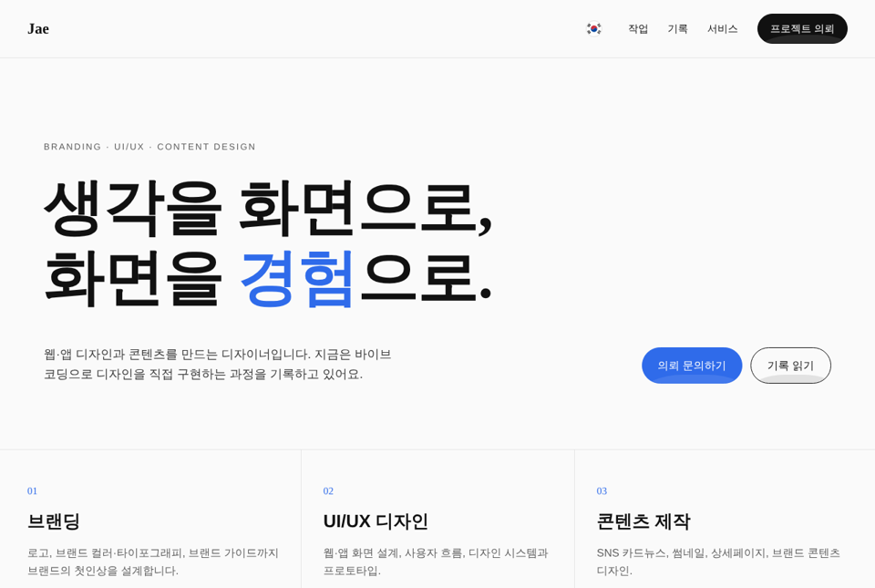 | 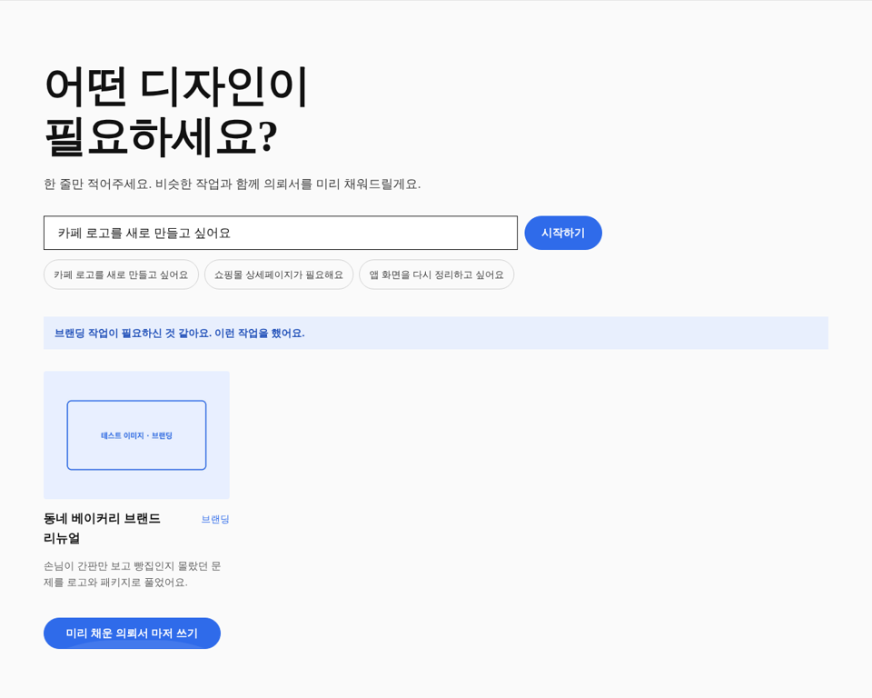 | 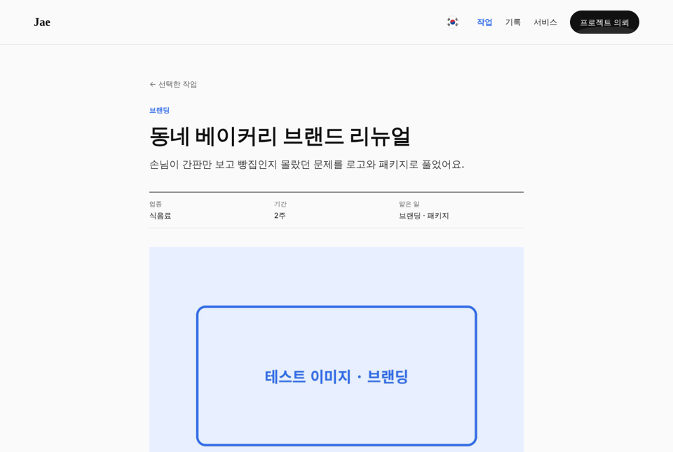 | 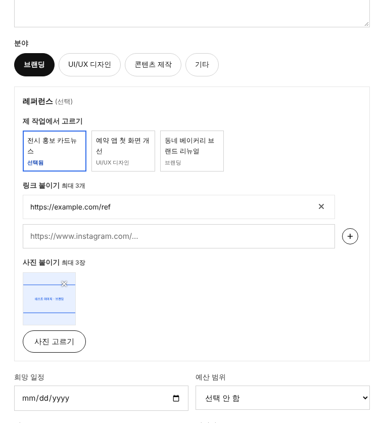 | 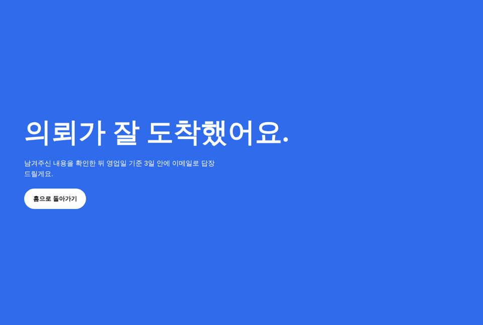 | 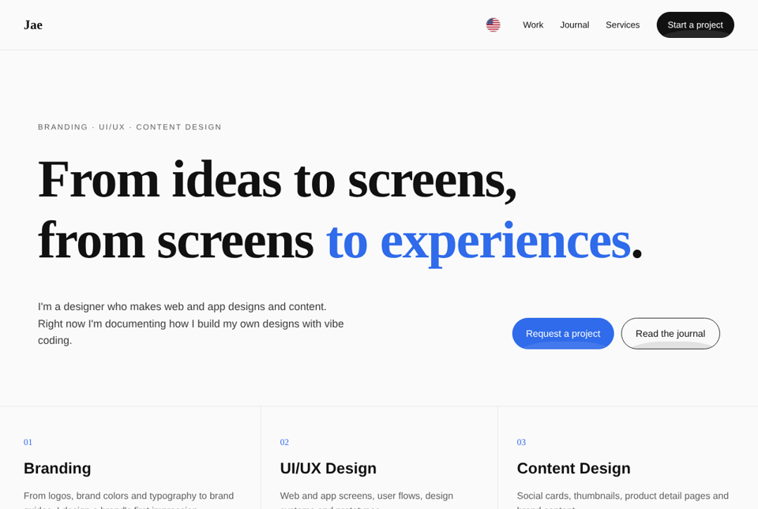 |
| **⑦ 작업 관리** | **⑧ 초안 작성** | **⑨ AI 꺼짐 → 대체** | **⑩ 미리보기** | **⑪ 게시 완료** | **⑫ 인스타 문구** |
| 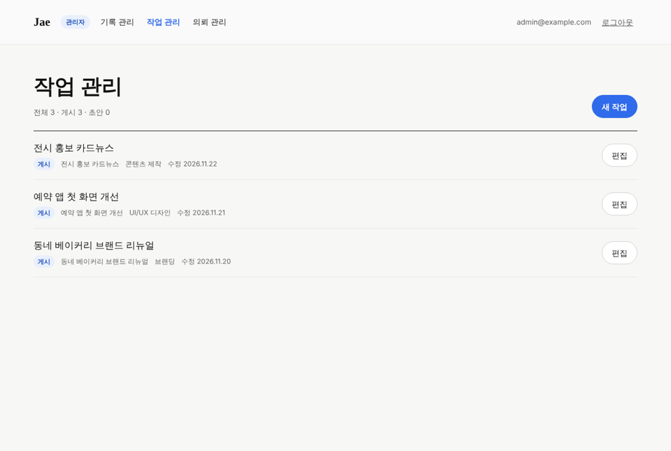 | 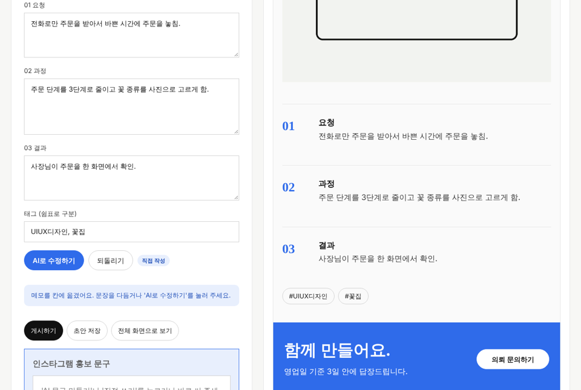 | 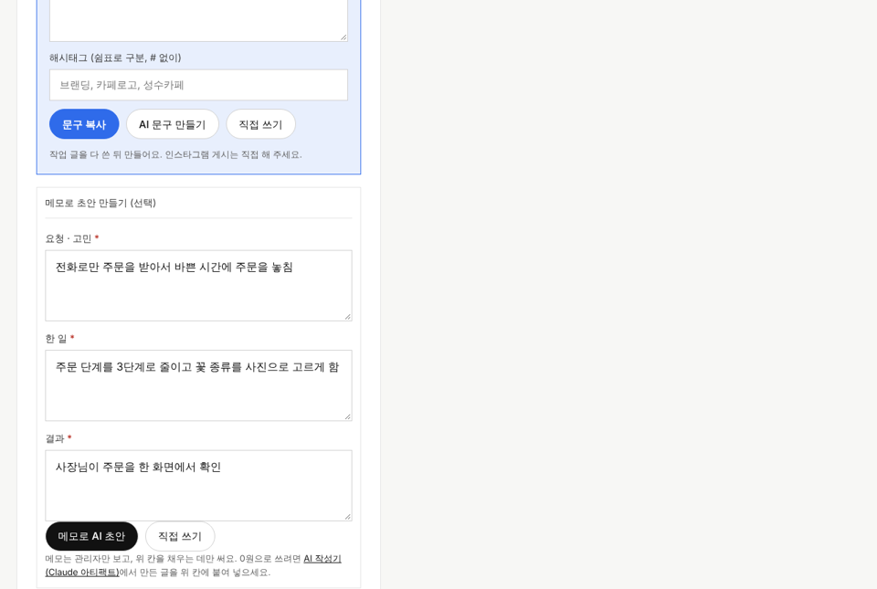 | 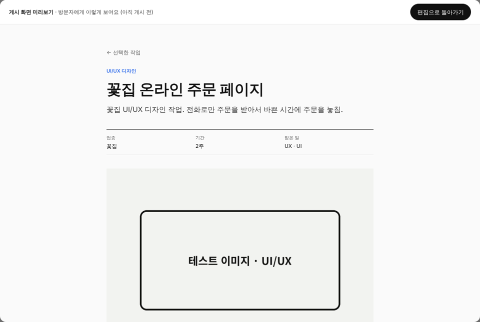 | 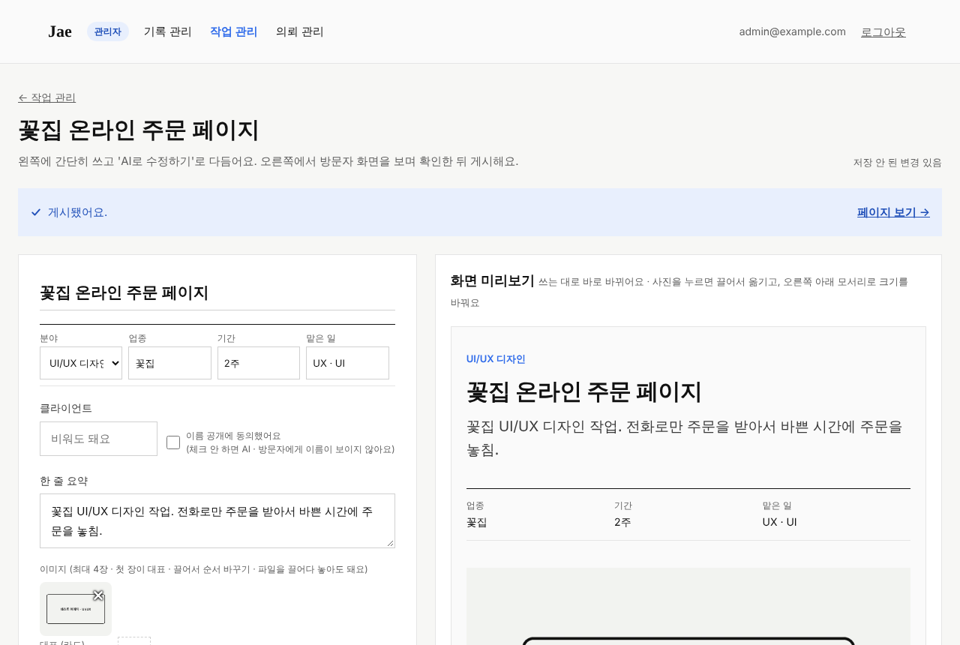 | 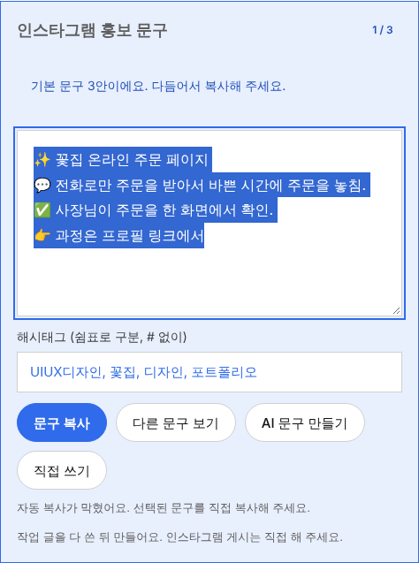 |

**방문자** 홈 → 한 줄 의뢰 → 작업 상세 → 의뢰서 → 접수 / **운영자** 메모 · 간단 작성 → AI로 수정 → 확인 → 게시 → 문구 복사

## 4. 테스트 결과: 성공 · 실패 · 예외 케이스
**방법**: 실제 사이트 코드 자동 테스트(Playwright, 가짜 Firebase) 37건 · 보안 규칙 테스트(에뮬레이터) · 운영자 실측 4건 · 휴리스틱 평가 · 실제 방문자 GA4.

| PRD 항목 | 테스트 | 결과 |
|---|---|---|
| F1 · F2 한 줄 의뢰 · 의뢰서 · English | 분야 추정, 미리 채움, 입력 오류 막기, 레퍼런스 · 사진 · 저장, 언어 전환 | **성공** 10건 (V01–03 · V06–10b · A09) |
| F3 작업 상세 · 목록 | 요청 · 과정 · 결과, 게시 작업 노출, 타이틀 이미지 · 순서 유지 | **성공** 10건 (V04 · V05 · A08 · C01–07) |
| F4–F7 작성기 | 로그인, 메모 없이 초안 막기, AI 꺼짐 → 대체, 미리보기 · 게시 · 문구 3안 | **성공** 8건 (A01–07 · A11) |
| 비기능 · 공통 | 360px 가로 넘침 없음, 모바일 헤더 한 줄, 버튼 44px, 스크립트 오류 0건 | **성공** 9건 (N01–06 · V11 · A10 · C08) |
| 보안 규칙 | 방문자 쓰기 · 초안 읽기 거부, 관리자만 쓰기, 의뢰는 만들기만 | **성공** 작업 21 · 분야 10 · 의뢰 7 |
| H3 게시 시간 · H4 그대로 쓴 문단 | 운영자 실측 4건 | **성공** 72분(평균 18분) · 63.8% |
| H4 메모에 없는 사실 | 운영자 실측 | **실패** 1건 (4건째 순서가 바뀌어 말뜻 변경) |
| H1 · H2 · H6 방문 · 전환 | GA4 11/24–25 | **판단 보류** 사용자 5명(표본 30명 미만) |

**실패 → 해결 (35건 중 주요)**: 두 번째 저장 시 invalid-argument(임시 시간값 저장) → 서버 값 다시 읽기 / 배포했는데 옛 화면 → HTML `no-cache` / 사진이 잘리고 흐림 → 원본 비율 · 2000px 단계 축소 / UTM이 기록에서 지워짐 → `utm_*` 유지 / 휴리스틱으로 메모 칸을 옮겼으나 운영자가 불편 → **되돌림**.

**예외 케이스 (13건 처리)**: AI 서버 꺼짐 · 키 없음 → 직접 쓰기 · 안내 / AI가 없는 숫자 생성 → 경고 · 되돌리기 / 의뢰 저장 실패 → 메일은 그대로 / 사진 3장 초과 · 10MB 초과 → 빼고 안내 / 예전 분야 '기타' → 편집디자인으로 / 날짜 없는 작업 기간 → 목록 맨 뒤 / 평가자 계정 쓰기 → 규칙에서 거절 · 시간 만료.

## 5. 기술 스택 · AI 활용
HTML · CSS · JS(빌드 없음), Firebase(Firestore · Auth · Hosting · 보안 규칙), GitHub Actions 자동 배포, **Claude API**(구조화 출력 · 사실만 쓰는 시스템 프롬프트 · 버전 관리), GA4 이벤트 · UTM, Python EDA(pandas · matplotlib). 개발은 Claude Code 에이전트와 지침 파일(`CLAUDE.md` · `AGENT_GUIDE.md`)로 진행, 커밋 190여 개 · 결정 39건 기록.

## 6. 회고
- **잘한 점**: AI 서버를 못 켜는 상황에도 운영자 키 · 직접 쓰기로 흐름을 끊지 않았고(비용 0원), 결정 · 실패를 모두 기록해 과정을 추적할 수 있게 함.
- **아쉬운 점**: 방문자 데이터가 5명이라 핵심 가설(H1 · H2)을 판단하지 못함. AI가 사실의 순서를 바꾸는 실패 1건 — 숫자 검사만으로는 부족함. 사용성 테스트를 지인 대신 운영자 실측 · 휴리스틱으로 대체함.
- **배운 점**: AI가 코드를 빨리 쓸수록 사람은 문제 정의 · 검토 · 승인이 더 중요함. 평가 점수보다 실제 사용자의 흐름이 우선(H1 되돌림).
- **다음 단계**: 'AI PM 역할' 글 크롤링 → 블로그 글, LinkedIn · 커뮤니티 UTM으로 4주 측정(12/22), 프롬프트에 '순서 · 인과 유지' 추가 후 재실측, 실제 의뢰 1건(KR4).
