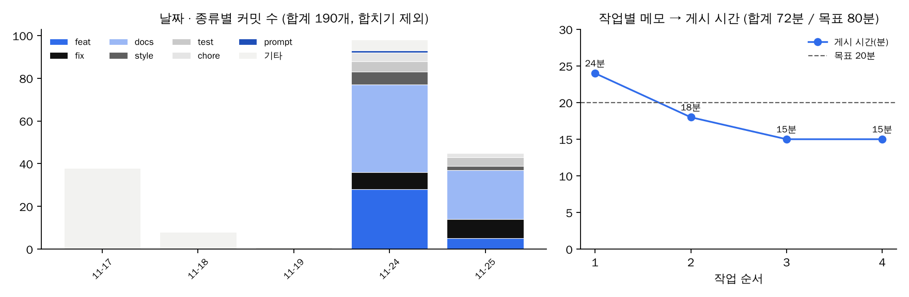

# 결과보고서: AI 케이스 스터디 작성기 (Jae 블로그)

v1.1 · 2026-11-25 · J · 배포 https://blog---261117.web.app · GitHub https://github.com/YJ-Choi746/blog-261117 · [PRD](PRD.md) · [테스트 보고서](TEST_REPORT.md)

## 1. 프로젝트 개요
1인 디자이너 블로그에 **"메모 → AI 초안 → 사람 확인 → 게시 → 인스타그램 문구"** 흐름을 만들어, 운영자는 작업을 케이스 스터디로 빨리 정리하고 방문자는 작업 과정을 읽고 한 줄로 의뢰하게 함. 실제 작업 4건을 **72분**(목표 80분)에 게시, 실제 사이트 자동 테스트 **37/37**.

## 2. 수업에서 배운 것 → 프로젝트 적용
| 배운 것 | 프로젝트에 쓴 방법 |
|---|---|
| AI 개발 환경 · Git | Claude Code로 기획 · 개발 · 테스트, 규칙 파일 `CLAUDE.md`(.cursorrules 역할), 커밋 190개 · `feat` · `fix` · `docs` 커밋 규칙 |
| Firebase · DB · 배포 | Firestore DB, 로그인, 보안 규칙, Firebase Hosting + GitHub Actions 자동 배포 |
| Web/API · 서버 구조 | 서버 함수로 AI 호출(키는 Secret Manager), 화면 → Firestore → 메일 데이터 흐름 |
| Frontend · 디자인 시스템 | 토큰 기반 디자인 시스템, 360px 모바일, 한국어 ⇄ English |
| LLM · AI API | Claude API로 초안 · 'AI로 수정하기' · 인스타그램 문구 3안, JSON 구조화 출력, 실패 시 대체 흐름 |
| 프롬프트 엔지니어링 | 시스템 프롬프트(역할 · "메모에 있는 사실만" · 출력 칸 · 문체), 태그로 지시문 주입 막기, 없는 숫자 검사, 버전 관리 |
| AI Agent · 워크플로우 | 사람이 확인하는 자동화(초안 → 검토 → 게시 → 홍보 문구), 개발은 에이전트 · 하위 에이전트로 분담, 결정 39건 기록 |
| Python · 데이터 분석 | `analysis/eda_project.py`: 수집 → pandas 전처리 → matplotlib 시각화 |

## 3. 미니프로젝트 수행 결과
**① 데이터 수집 · 전처리 · EDA 시각화** — 저장소 커밋 기록(git log)과 운영자 실측 4건을 모아, 시간대(KST) 맞추기 · 커밋 종류 분류 · 합치기 커밋 제외로 정리함.

- 커밋은 11/24(98개) · 11/25(45개)에 몰렸고 문서(docs)가 가장 많음. 게시 시간은 24 → 18 → 15 → 15분, 2건째부터 목표(20분) 안.

**② 웹 크롤링 (다음 단계, 설계 완료)** — 'AI PM의 역할'을 다룬 글들을 크롤링(requests · BeautifulSoup)해 본문만 남기고(전처리), 자주 나오는 역할 · 역량 키워드를 세어(EDA), 그 인사이트로 블로그 기록 글을 씀. 이 작업 환경은 외부 사이트 접속이 막혀 있어 수집은 운영자 PC에서 진행할 예정.

**③ 실무 AI 기능 (LLM · API)**

| 지표 | 목표 | 결과 |
|---|---|---|
| 작업 게시 시간 | 4건 80분 | 72분 **달성** |
| 메모에 없는 사실 · 그대로 쓴 문단 | 0건 · 60% | 1건 **미달** · 63.8% **달성** |
| 24시간 순방문자 · 전환율 | 30명 · 5% | 5명, 표본 부족으로 **판단 보류** |

## 4. 어려웠던 점과 해결
- **AI 서버 비용**: 유료 요금제 대신 운영자 키 · 직접 쓰기로 **비용 0원** 운영.
- **AI가 말뜻을 바꿈**: 4건째 초안 1건 → 프롬프트에 '순서 · 인과 유지'를 넣을 예정.
- **사용자 피드백 우선**: 휴리스틱으로 옮긴 메모 칸을 운영자 피드백으로 되돌림. 실패 · 해결 35건 기록.

## 5. 소감과 다음 단계
비전공자로서 AI의 도움으로 **문제 정의 → 화면 → DB · 보안 → AI 기능 → 배포 → 측정**까지 한 서비스를 끝까지 만들어 봄. AI가 코드를 빨리 쓰는 만큼 사람은 문제를 정확히 정의하고 결과를 검토 · 승인하는 일이 더 중요함을 배움. **다음**: AI PM 글 크롤링 → 블로그 글, UTM 4주 측정, 프롬프트 개선 후 재실측, RAG로 지난 작업 활용.
