# 테스트 보고서: AI 케이스 스터디 작성기 (Jae 블로그)

| 항목 | 내용 |
|---|---|
| 문서 버전 | v1.2 (기준: PRD v1.2 기능 번호 F1~F7, 프로토타입 `prototype.html`) · 이전 버전은 커밋 기록 |
| 실행일 · 작성자 | 2026-11-24 · J |
| 방법 | Playwright + Chromium 자동 테스트 `tests/e2e_prototype.py` (데스크톱 1280×860, 모바일 390×844) |
| 결과 | **24건 중 24건 통과** (관리자 10 · 사용자 13 · 비기능 1), 사이트 구현 테스트도 모두 통과 (4장) |

## 1. 유저플로우 스크린샷 (프로토타입)

관리자가 게시해야 사용자 화면에 작업이 보여서 관리자 흐름을 먼저 실행했어요. **노란 형광펜**은 확인한 부분, 괄호는 테스트 ID예요. **관리자: 메모 입력 → AI 초안 → 미리보기 → 게시 → 인스타그램 문구**

| ⑦ 작업 정보 · 메모 입력 (F4 · A-01) | ⑧ 초안 편집 (F5 · A-03) | ⑨ 게시 화면 미리보기 (F6 · A-04, A-05) |
|---|---|---|
| 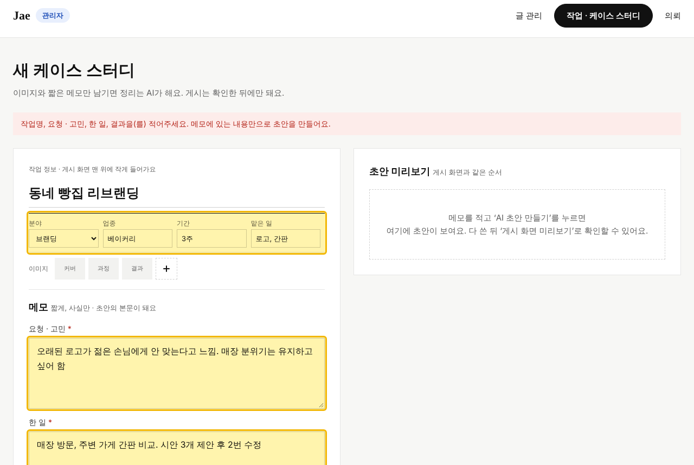 | 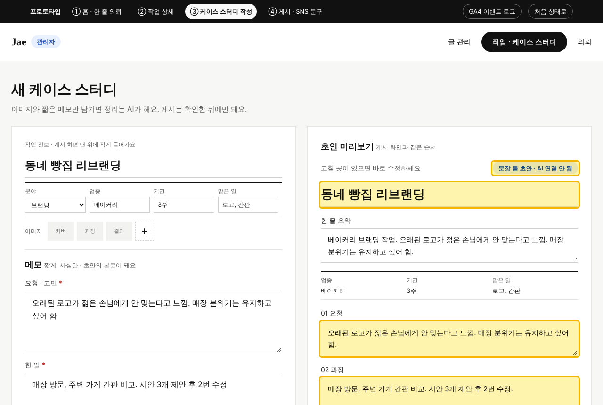 | 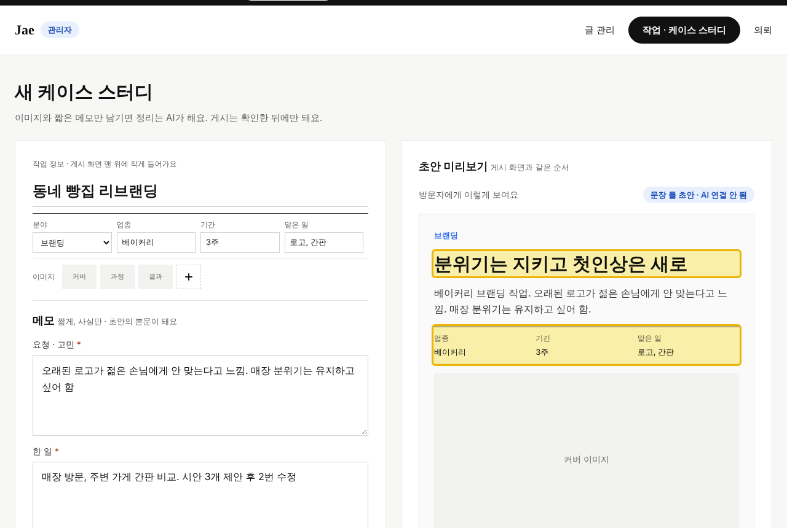 |
| **⑩ AI 실패 시 직접 쓰기 (F6 · A-02)** | **⑪ 게시 완료 · 인스타그램 문구 (F6 · F7 · A-06~A-09)** | |
| 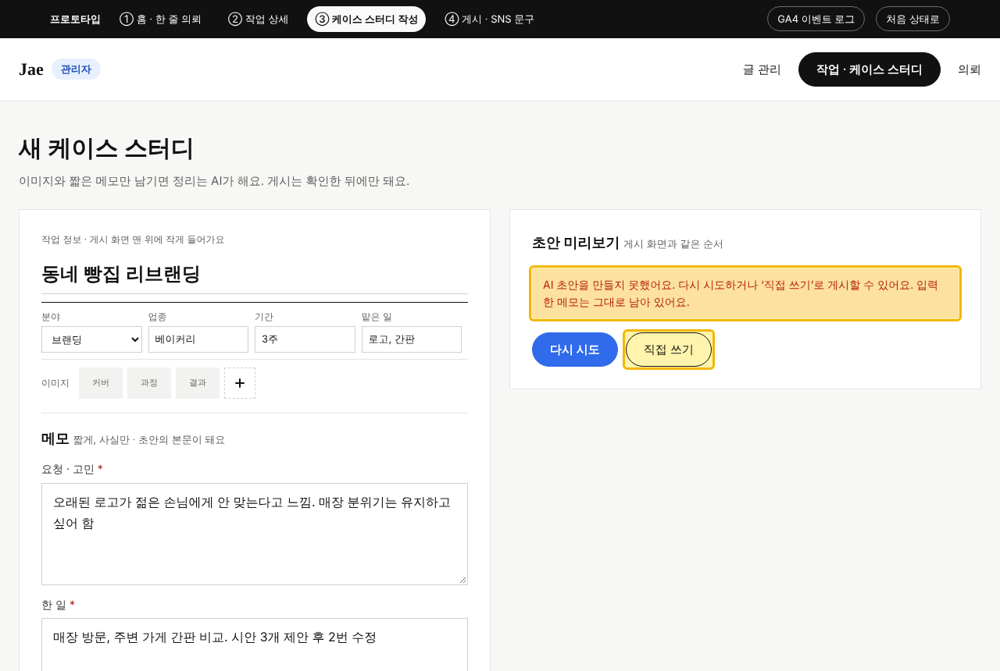 | 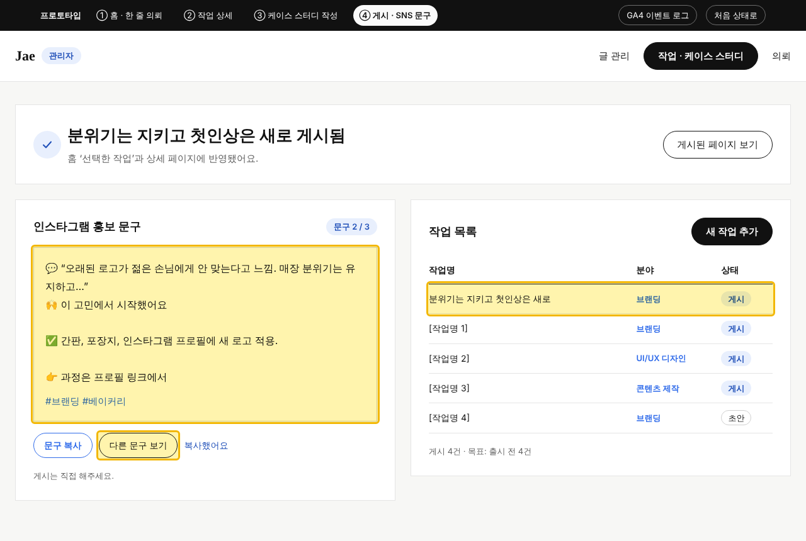 | |

**사용자: 홈 → 한 줄 의뢰 → 입력 확인 → 접수 → 작업 상세 → 의뢰 창**

| ① 홈 · 한 줄 의뢰 (F1 · U-01) | ② 레퍼런스 첨부 (F2 · U-05) | ③ 이름 · 이메일 오류 안내 (F2 · U-03, U-04) |
|---|---|---|
| 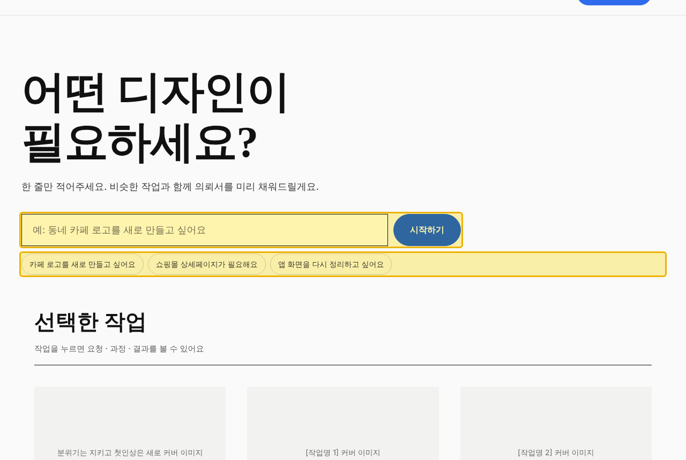 | 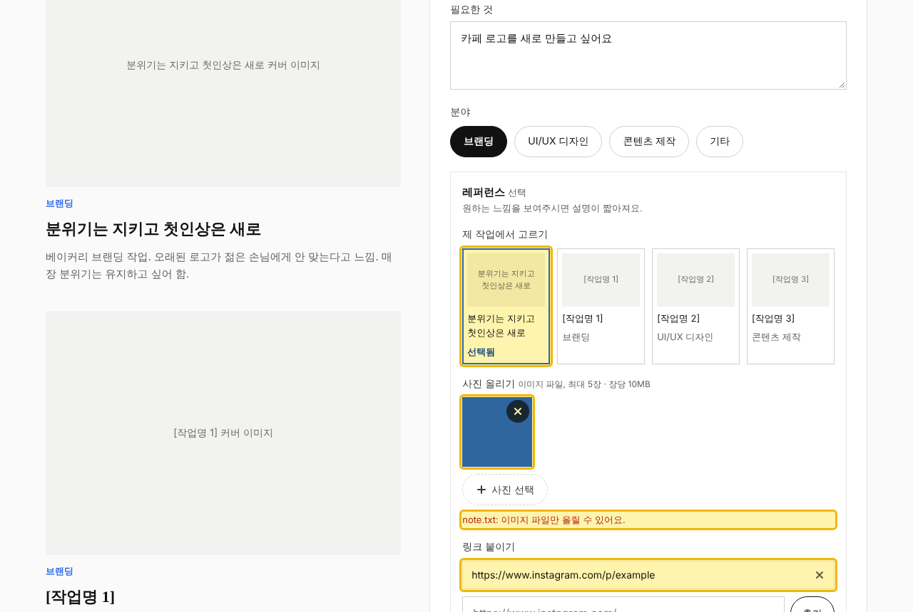 | 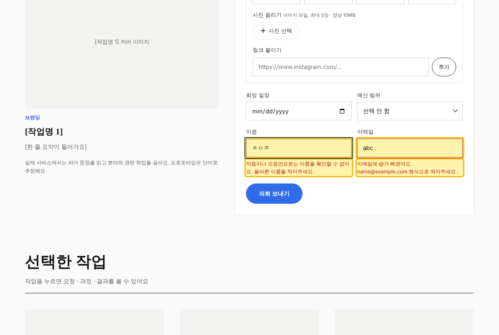 |
| **④ 접수 완료 (F2 · U-07)** | **⑤ 상세 · 다른 프로젝트 보기 (F3 · U-08, U-09)** | **⑥ 의뢰 창 · 사진 선택 · 정렬 (F2 · U-06, U-10~U-12)** |
| 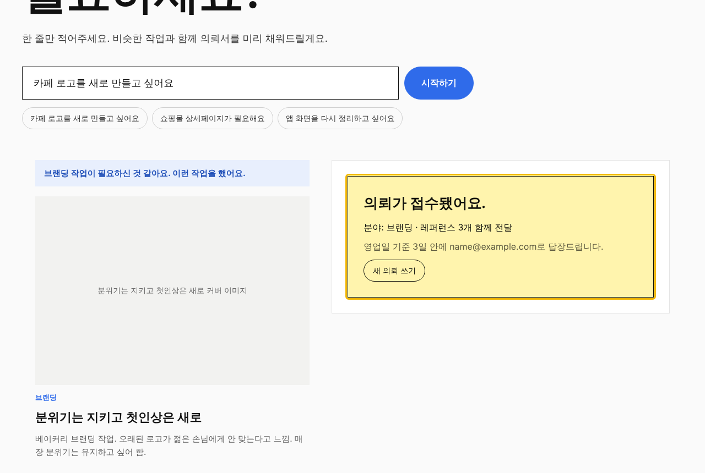 | 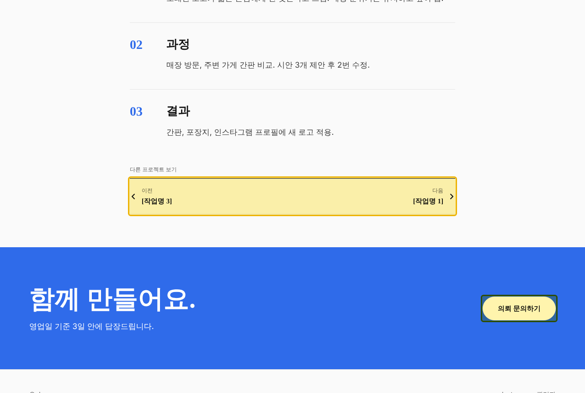 | 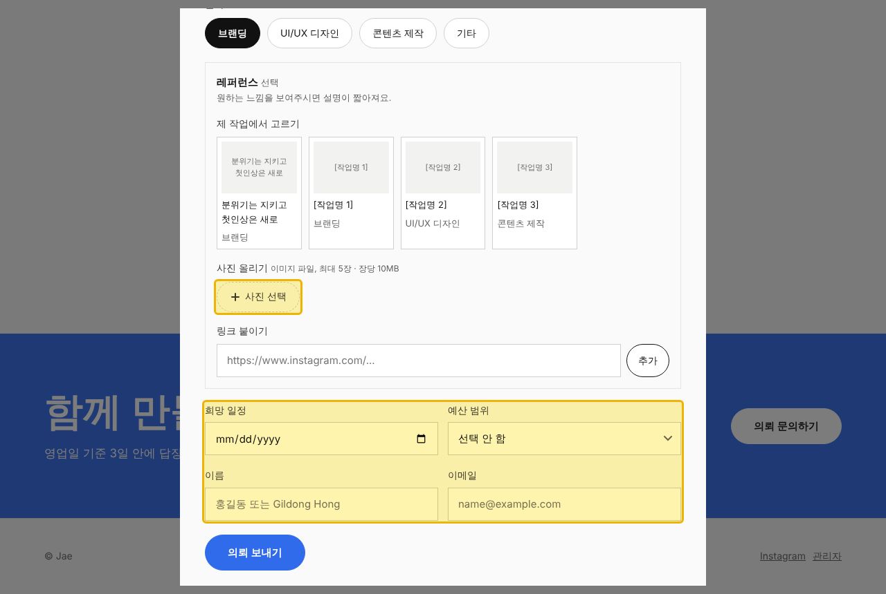 |

## 2. 기능별 단위 테스트: 관리자

| ID | PRD | 테스트 | 기대 결과 | 결과 |
|---|---|---|---|---|
| A-01 | F4 | 필수 메모를 비우고 'AI 초안 만들기' | 생성을 막고 빠진 항목 안내 | 통과 |
| A-02 | F6 | AI 응답 실패 상황 시험 | 오류 안내, 메모 유지, '직접 쓰기' | 통과 |
| A-03 | F5 | 메모로 초안 생성 | 제목 · 요청 · 과정 · 결과 채움, 출처 배지 | 통과¹ |
| A-04 | F6 | 초안 버튼 배치 | 버튼 4개가 한 줄 | 통과 |
| A-05 | F6 | 게시 화면 미리보기 | 편집한 제목이 게시 화면에 반영 | 통과 |
| A-06 | F6 | 게시하기 | 작업 목록 맨 위에 '게시' 상태로 추가 | 통과 |
| A-07 | F7 | 문구 확인 · '다른 문구 보기' | 이모지가 줄 앞(4/4줄), 다른 문구로 바뀜 | 통과 |
| A-08 | F7 | 문구 복사 | "복사했어요" 표시 | 통과 |
| A-09 | F7 | 채널 정리 | 인스타그램 문구만 표시, 비핸스 없음 | 통과 |
| A-10 | F6 · F3 | '직접 쓰기' 후 초안 저장 | 게시한 작업만 홈에 노출 | 통과 |

## 3. 기능별 단위 테스트: 사용자

| ID | PRD | 테스트 | 기대 결과 | 결과 |
|---|---|---|---|---|
| U-01 | F1 | 한 줄 의뢰 빈 입력 | "한 줄로 적어주세요" 안내 | 통과 |
| U-02 | F1 | "카페 로고를 새로 만들고 싶어요" | 브랜딩 추정, 관련 작업, 의뢰서 자동 입력 | 통과¹ |
| U-03 | F2 | 이름 6개 입력 | `최연재` `Yeonjae Choi` 통과 / `ㅊㅇㅈ` `최ㅇ재` `홍1` `J` 안내 | 통과 |
| U-04 | F2 | 이메일 5개 입력 | `name@example.com` 통과 / `abc` `a@b` `a@@b.com` `a@b..com` 안내 | 통과 |
| U-05 | F2 | 레퍼런스 첨부 | 내 작업 선택, 잘못된 링크 안내, png 업로드 · txt 거부 | 통과 |
| U-06 | F2 | 희망 일정 · 예산 · 이름 · 이메일 정렬 | 네 칸 높이 48px, 너비 동일 | 통과 |
| U-07 | F2 | 올바른 값으로 제출 | 접수 화면에 분야 · 레퍼런스 3개 표시 | 통과 |
| U-08 | F3 | 작업 상세의 의뢰 입구 | 본문 버튼 없음, 하단 배너에만 의뢰 버튼 | 통과 |
| U-09 | F3 | 다른 프로젝트 보기 | 다음 → 다른 작업, 이전 → 원래 작업 | 통과 |
| U-10 | F2 | 하단 배너 '의뢰 문의하기' | 폼만 있는 창이 열림 | 통과 |
| U-11 | F2 | '사진 선택' 버튼 | 아이콘과 글자 한 줄(44px) | 통과 |
| U-12 | F2 | 희망 일정 | 날짜 직접 선택, '선택' 표시 없음 | 통과 |
| U-13 | 참고 | 퍼널 이벤트 기록 | 조회 → 의뢰 버튼 → 시작 → 제출 순서 | 통과² |
| N-01 | 비기능 | 모바일 390px | 가로로 밀리지 않음(scrollWidth 390) | 통과 |

## 4. 미실행 항목과 남은 일

| PRD | 항목 | 상태 | 다음 조치 |
|---|---|---|---|
| F5 | 실제 Claude 초안 품질(메모에 없는 사실 0건, 한 건 10분) | **미실행** | AI 작성기 아티팩트에서 실제 작업 4건으로 확인 후 기록 |
| 가설 3 · 4 | 지인 5명 사용성 테스트(의뢰 의향, 한 줄 의뢰 3분) | **미실행** | 11/25 오전 진행 후 기록 |

**실제 사이트 구현 테스트** (가짜 Firebase + 크롬, 에뮬레이터, 단위 테스트): F1 · F2 화면 6/6 · 규칙 7/7, F3 화면 6/6, F4 · F6 화면 7/7 · 규칙 18/18, F5 · F7 문장 틀 화면 통과 · 서버 20/20, v0.2 의뢰 기능 규칙 24/24 · 화면 10/10 모두 통과.

¹ 자동 테스트 환경에는 Claude 연결이 없어 **문장 틀 초안**과 **단어 기반 분야 추정**으로 실행했어요. 실제 운영에서는 AI 작성기 아티팩트가 운영자의 Claude 요금제로 초안을 만들어요(비용 0원, D27). ² GA4 이벤트(F8)는 범위에서 뺐어요(D28). 프로토타입 안의 기록만 확인했어요.

**알려진 제한**: 프로토타입의 게시 작업은 브라우저 저장소에만 남고 사진은 미리보기만 돼요(사이트는 Firestore 저장, 사진 첨부는 출시 이후). Google Fonts를 막아 시스템 글꼴로 캡처했어요. 실행 기록: [성공 실패 로그](SUCCESS_FAILURE_LOG.md)
