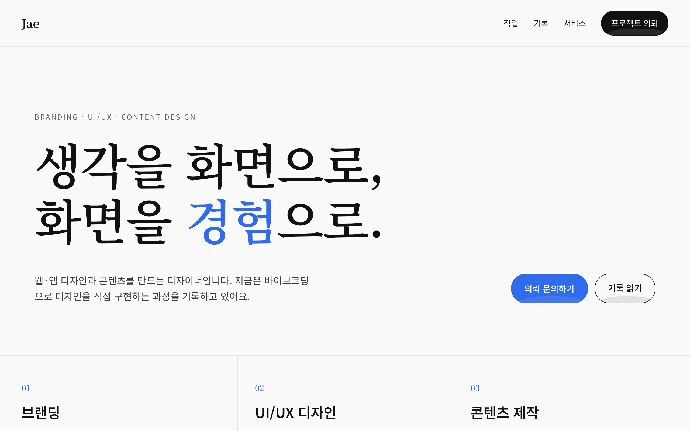
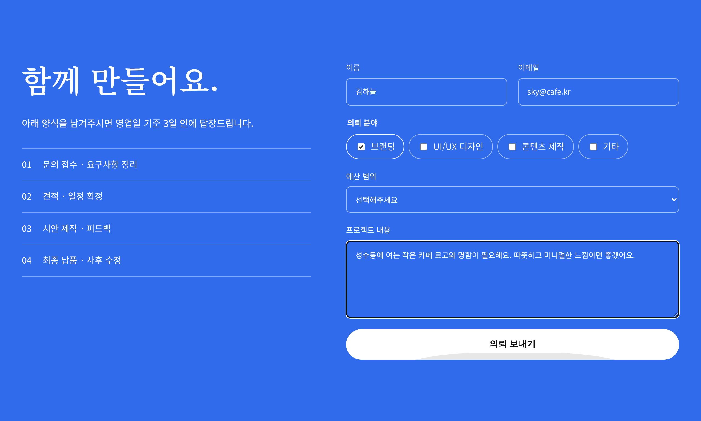
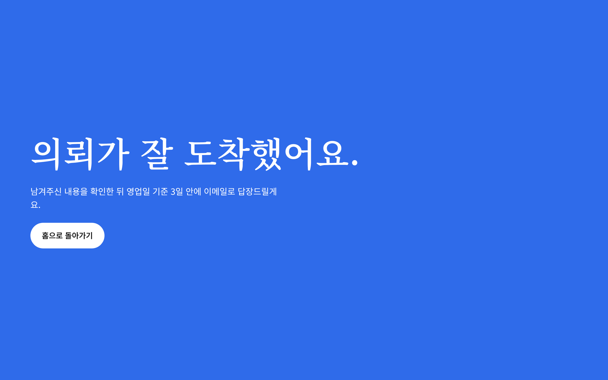
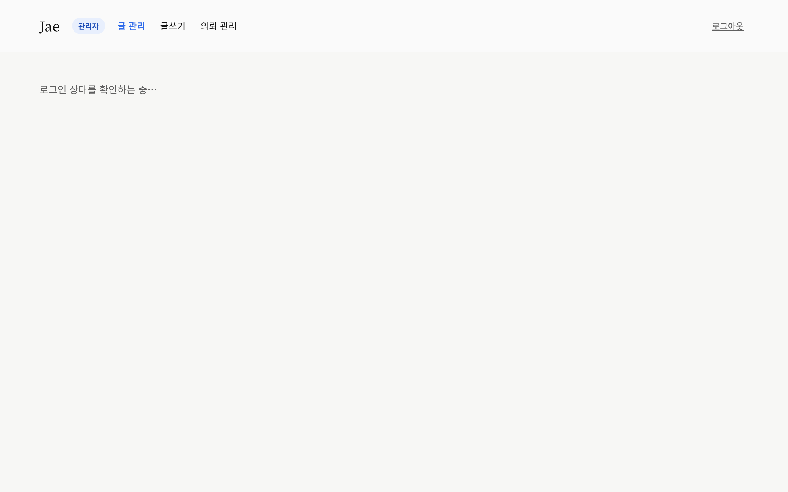
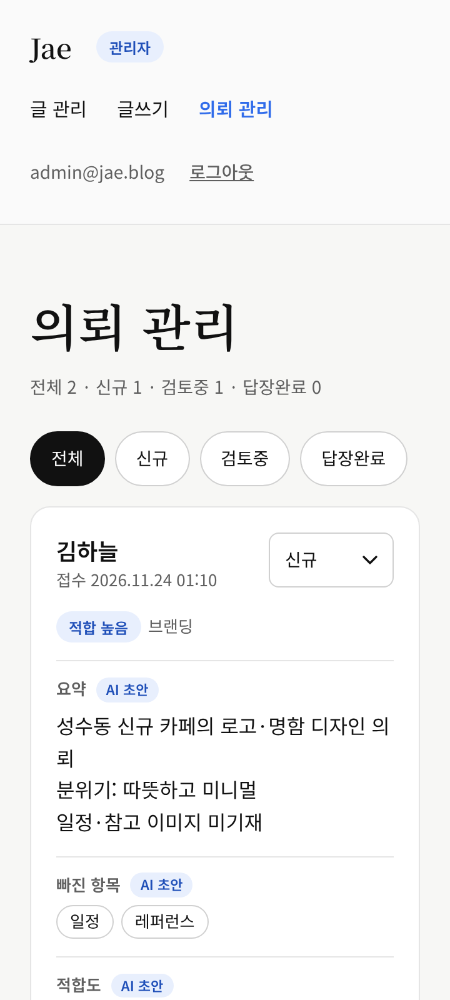

# 테스트 보고서 (Jae 블로그 AI 기능)

| 항목 | 내용 |
|---|---|
| 버전 | v0.1 중간 보고 (2026-11-24 11:00 KST) · 갱신은 커밋 기록으로 관리 |
| 대상 | v0.2 의뢰 기능: AI 분석 함수 · 의뢰 저장 · 관리자 의뢰 카드 (PRD v0.4 케이스 스터디 기능은 구현 후 추가) |
| 환경 | 크롬(Playwright) + 로컬 서버 + 가짜 Firebase, 보안 규칙은 Firestore 에뮬레이터, 함수는 Node 테스트(가짜 AI) |
| 한계 | 실제 AI 호출 · 실제 Firestore 저장은 아직 미검증 (함수 배포 · 보안 규칙 게시 전) |

## 1. 유저플로우 스크린샷

방문자: 첫 화면 → 의뢰 작성 → 보내는 중 → 완료 / 운영자: 로그인 → 의뢰 관리 카드

| ① 첫 화면 | ② 의뢰 작성 | ③ 보내는 중 (저장 → 메일) |
|---|---|---|
|  |  |  |
| **④ 완료 페이지** | **⑤ 관리자 로그인** | **⑥ 의뢰 관리 (휴대폰 360px)** |
|  |  |  |

⑧ 작업 편집 (입력 좌 · AI 초안 우, 숫자 경고) → [`screenshots/08-work-editor.png`](screenshots/08-work-editor.png) · ⑦ 의뢰 관리 카드 (데스크톱): 위는 AI 분석 성공(요약 → 빠진 항목 → 적합도, 'AI 초안' 배지), 아래는 AI 실패 시 원문 + 다시 분석 → [`screenshots/06-admin-requests.png`](screenshots/06-admin-requests.png)

## 2. 기능별 단위 테스트

| 기능 | 테스트 | 결과 | 주요 확인 내용 |
|---|---|---|---|
| AI 분석 함수 `analyzeRequest` | `functions/test/analyze.test.js` (`npm test`) | **8/8 통과** | 입력 검사, 이름·이메일 미전달, 태그 주입 차단, JSON 파싱·검증, check는 누락만, 실패 5종(파싱·거절·토큰 초과·타임아웃·API 오류) → 오류 대신 `ok:false` |
| AI 케이스 스터디 생성 `generateCaseStudy` (PRD v0.5 F2) | `functions/test/casestudy.test.js` | **7/7 통과** | 입력 검사, 실명 비공개 시 미전달, 메모에 없는 숫자 검출(30%·1,200명), 실패 시 `ok:false`(빈 템플릿 경로) |
| 작업 편집 `admin/work.html` (F1 · F3 · F7) | 크롬 + 가짜 Firebase · 에뮬레이터 | **7/7 · 규칙 18/18 통과** | AI 초안 채움·숫자 경고, AI 실패 시 직접 작성 후 게시, 빈 칸 게시 차단, 메모·비공개 실명은 관리자 문서에만 |
| 의뢰 저장 보안 규칙 | Firestore 에뮬레이터 | **24/24 통과** | 방문자는 만들기만, 읽기·수정·삭제는 관리자만, 추가 필드·3000자 초과·잘못된 이메일·가짜 시각 거부, 기존 규칙 회귀 없음 |
| 의뢰 폼 저장 `js/request-form.js` | 크롬 + 가짜 Firebase | **4/4 통과** | 성공 시 메일에 의뢰번호 / 저장 실패 시 메일 즉시 / 응답 없음 시 3초 후 메일 / 스팸 칸이면 저장 안 함, 두 번 클릭해도 1회 |
| 관리자 의뢰 카드 `admin/requests.html` | 크롬 + 가짜 Firebase | **6/6 통과** | 판단 순서·배지·스팸 표시, 미분석 건만 자동 분석 1회, 실패 시 원문·다시 분석, 상태·답장 시각 저장, XSS 차단, 360px·버튼 44px |

## 3. 실패와 조치

| 실패 | 원인 | 조치 |
|---|---|---|
| 함수 테스트가 0건 실행 | `node --test test/` 경로 지정 오류 | `test/*.test.js`로 수정 |
| 폼 화면 테스트 멈춤 | 외부 글꼴·분석 스크립트 로딩 대기 | 테스트에서 외부 요청 차단, DOM 로드까지만 대기 |
| 실제 AI 분석 불가 | Blaze 요금제 · API 키 미등록 | 배포 안내를 `docs/firebase-setup.md`에 작성, 등록 후 재측정 예정 |

자세한 실행 기록: [SUCCESS_FAILURE_LOG.md](SUCCESS_FAILURE_LOG.md) · 완료 기준별 결과: [user-stories.md](user-stories.md) US-15 · US-16
