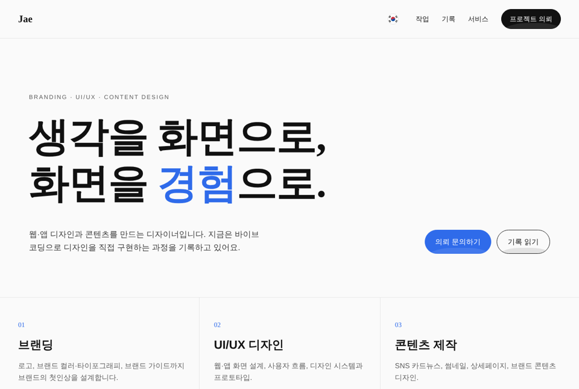
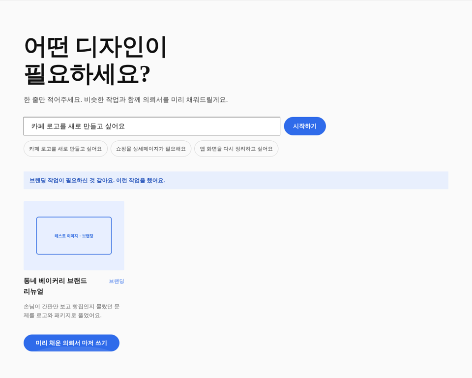
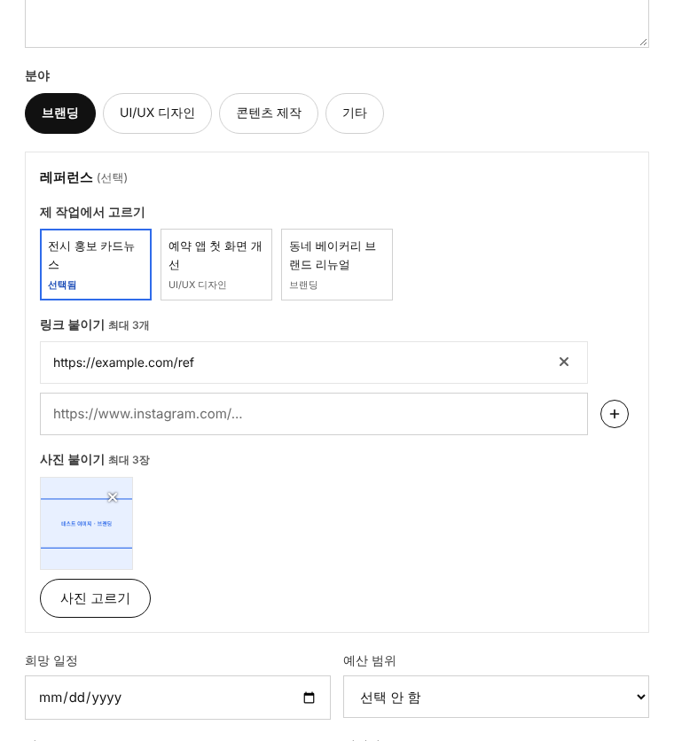
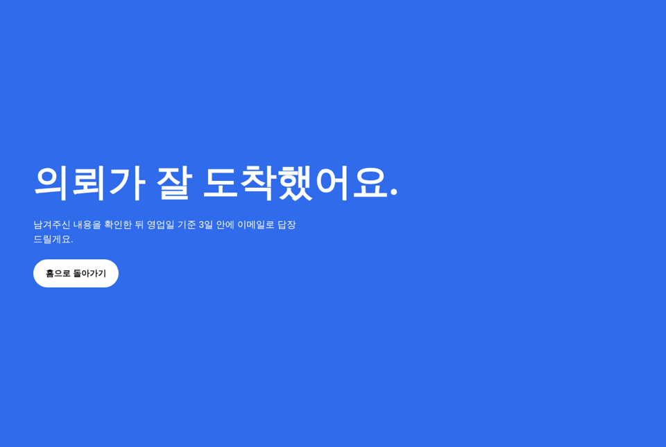
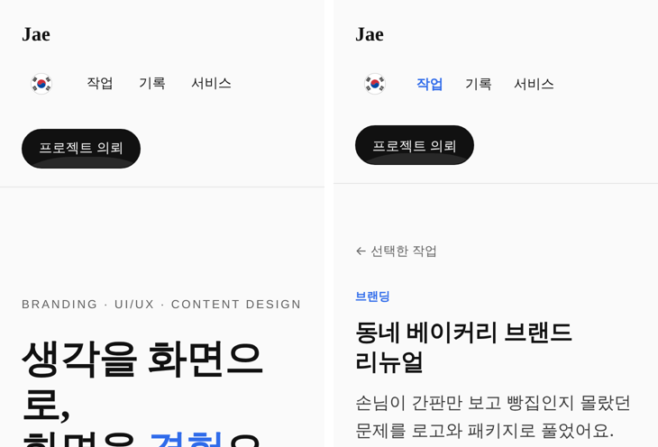
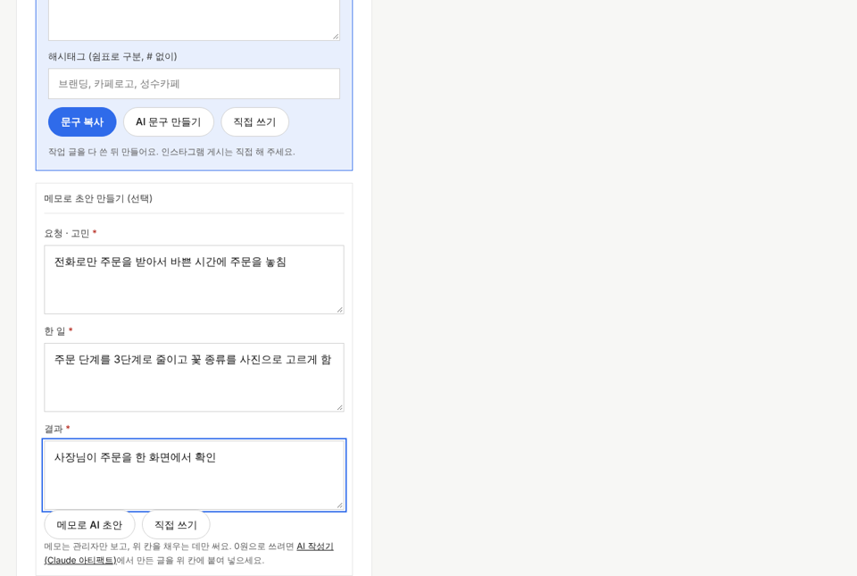
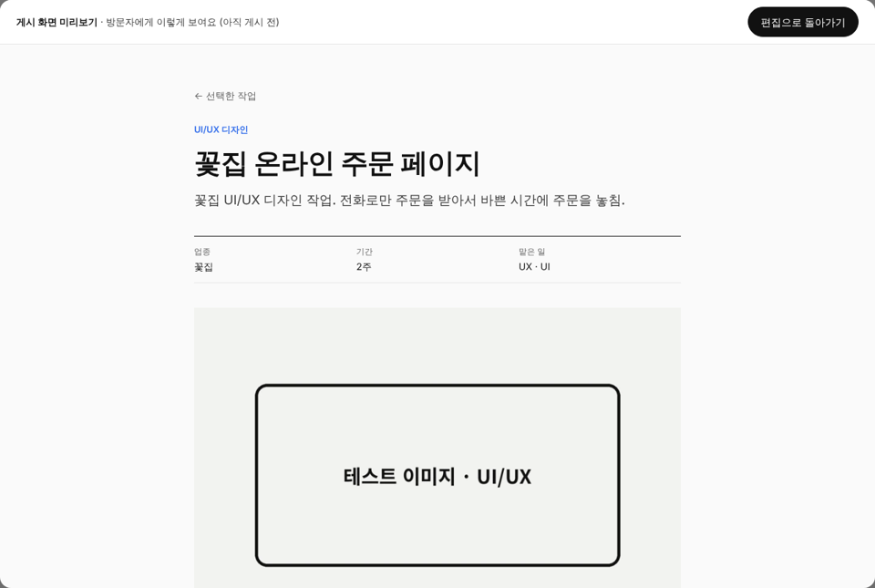
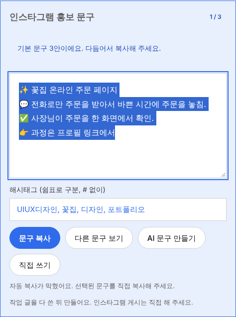

# 테스트 보고서: AI 케이스 스터디 작성기 (Jae 블로그)

| 항목 | 내용 |
|---|---|
| 문서 버전 · 작성 | v1.3 (기준 PRD v1.5, 이전 버전은 커밋 기록) · 2026-11-25 · J |
| 대상 | **실제 사이트 코드**(`main`)를 로컬에서 실행, Firebase만 가짜 데이터로 대체 · 크롬 1280×860, 모바일 360×780 |
| 방법 | 자동 테스트 [`tests/site-flow/`](../tests/site-flow/) 33건(`flow.js` 25 · `cover.js` 8) + 운영자 실측 + 휴리스틱 평가 + 실제 방문자 GA4 (D35) |
| 결과 | **자동 33건 중 33건 통과** (방문자 12 · 비기능 3 · 관리자 10 · 타이틀 이미지 8), 화면 스크립트 오류 0건 |

## 1. 유저플로우 스크린샷 (실제 사이트)

화면의 작업 3건은 테스트용 예시 데이터임. 원본과 전체 화면은 [screenshots/site/](screenshots/site/), 이전 프로토타입 기준 24/24는 v1.2 커밋에 있음.
**방문자: 홈 → 한 줄 의뢰 → 작업 상세 → 의뢰서 → 접수 / 관리자: 메모 → 초안 → 미리보기 → 게시 → 문구**

| ① 홈 (V-01) | ② 한 줄 의뢰 · 분야 추정 (F1 · V-03) | ③ 작업 상세 (F3 · V-04) | ④ 입력 오류 안내 (F2 · V-07) | ⑤ 레퍼런스 · 사진 (F2 · V-08) | ⑥ 접수 완료 (V-09) |
|---|---|---|---|---|---|
|  |  |  |  |  |  |
| **⑦ English (V-10)** | **⑧ 모바일 360px (N-01 · N-02)** | **⑨ 메모 입력 (F4 · A-02)** | **⑩ AI 꺼짐 → 문장 틀 (F5 · A-03)** | **⑪ 게시 미리보기 (F6 · A-05)** | **⑫ 인스타그램 문구 (F7 · A-07)** |
|  |  |  |  |  |  |

## 2. 기능별 단위 테스트 (자동 33건, 모두 통과)

| ID | PRD | 테스트 → 기대 결과 |
|---|---|---|
| V-01~V-03 | F1 | 홈 헤딩 · 의뢰 버튼 / 빈 한 줄은 결과 안 열림 / "카페 로고…" → 브랜딩 추정, 비슷한 작업 |
| V-04 · V-05 | F3 | 상세에 01 요청 · 02 과정 · 03 결과 / 작업 목록에 게시 작업 3건 |
| V-06~V-09 | F2 | 한 줄 · 분야 미리 채움 / `ㄱㄴㄷ` · `a@b` 안내와 제출 막음 / 레퍼런스 · 링크 · 사진 첨부 → 저장 1건, 접수 화면 |
| V-10 · V-10b | 방문자 | 한국어 → English, 새로고침 후 유지 |
| N-01~N-03 | 비기능 | 360px 홈 · 상세 가로 넘침 없음, 홈 버튼 44px 이상 |
| A-01 · A-02 | F4 | 로그인 / 메모 없이 'AI 초안' → "메모를 한 칸 이상 써 주세요" |
| A-03 · A-04 | F5 | AI 서버 꺼짐 → 안내 후 문장 틀로 대체, 메모 유지 / '직접 쓰기' |
| A-05~A-07 | F6 · F7 | 전체 미리보기에 제목 반영 / 게시 완료 패널 / 인스타그램 문구 3안 |
| A-08 · A-09 | F3 · F2 | 게시 작업이 방문자 목록에 / 방문자 의뢰가 관리자 의뢰 목록에 |
| C-01~C-07 | F4 · F3 | 3번째 썸네일을 누르면 타이틀(홈 화면 카드)로 지정 → 사진 순서 · 본문 배치 · 상세 맨 위는 그대로, 홈 카드만 바뀜, 다시 열어도 유지 (D36, [썸네일](screenshots/site/c01-cover-thumbs.png) · [홈](screenshots/site/c02-cover-home.png)) |
| V-11 · A-10 · C-08 | 공통 | 방문자 · 관리자 화면 스크립트 오류 0건 |

서버 · 보안 규칙 테스트(20/20, 18/18 · 24/24 · 7/7)는 [성공 실패 로그](SUCCESS_FAILURE_LOG.md)에 있음.

## 3. 사용성 평가 (지인 테스트 대체, D35)

**① 운영자 실측 (H3 · H4)**: 관리자 화면의 실제 사용자인 운영자가 실제 작업 4건을 게시하며 측정함(11/25).

| 작업 | 메모 → 게시 (목표 20분) | 메모에 없는 사실 (목표 0건) | 그대로 쓴 문단 (목표 60%) |
|---|---|---|---|
| 1 · 2 · 3 · 4 | 24 · 18 · 15 · 15분 | 0 · 0 · 0 · 1건 | 65 · 80 · 50 · 60% |
| 결과 | 평균 18분, 합계 72분 (목표 80분) **달성** | 합계 1건 **미달** | 평균 63.8% **달성** |

1건째만 24분으로 목표를 넘었고 2건째부터 20분 안으로 줄어듦. 4건째 초안은 운영자가 쓴 내용의 순서를 바꿔 말뜻이 달라진 곳이 1건 있어 KR2(0건)는 지키지 못함. 고친 곳은 대부분 '-했습니다' 체의 긴 문장을 줄이는 일이었음. → 다음 조치: 프롬프트에 '메모의 순서와 인과는 그대로', '짧은 해요체'를 넣고 실측을 다시 할 예정.

**② 휴리스틱 평가 (Nielsen 10원칙, 스크린샷과 측정값 기준)**

- **높음 · 시스템과 실제의 일치**: 메모 3칸이 편집 화면 맨 아래 접힌 '메모로 초안 만들기 (선택)' 안(페이지 2113px 중 1910px)에 있어 핵심 흐름이 선택 기능처럼 보임. → 작업 정보 바로 아래로 옮기고 펼쳐 두기
- **중간 · 미니멀 디자인**: 360px에서 헤더가 3줄로 첫 화면의 27%(208px)를 차지함. → 모바일 메뉴 한 줄로
- **낮음 · 가독성**: 모바일 홈 헤딩이 "화면으 / 로,"로 한 글자만 넘어감. → 헤딩에 `word-break: keep-all`
- **정보 · 가시성**: AI 작성기 아티팩트는 소유자만 열려 평가자가 볼 수 없음. → 작성기 화면 캡처 첨부

**③ 실제 방문자 GA4 (H1 · H2)**: 11/24~25 GA4 '사용자 획득' 보고서 기준 **사용자 5명**. 표본 30명 미만이고 공개 직후라 이벤트 집계도 늦어 case_view → request_click · form_start → form_submit 전환율은 **집계 지연 · 표본 부족으로 판단 보류**. 관리자 브라우저는 GA에서 제외해 실제 방문자만 셈. → 다음 조치: LinkedIn과 커뮤니티 UTM 링크로 4주간 모아 다시 판단할 예정.

## 4. 한계
배포 URL은 테스트 환경에서 열리지 않아 같은 코드를 로컬에서 실행함. 배포 사이트 방문자 화면은 `LIVE=1 BASE=https://blog---261117.web.app node flow.js`로 다시 찍을 수 있음(제출 · 관리자 단계 제외). H5 · H6은 공개 후 GA4로 확인할 예정.
