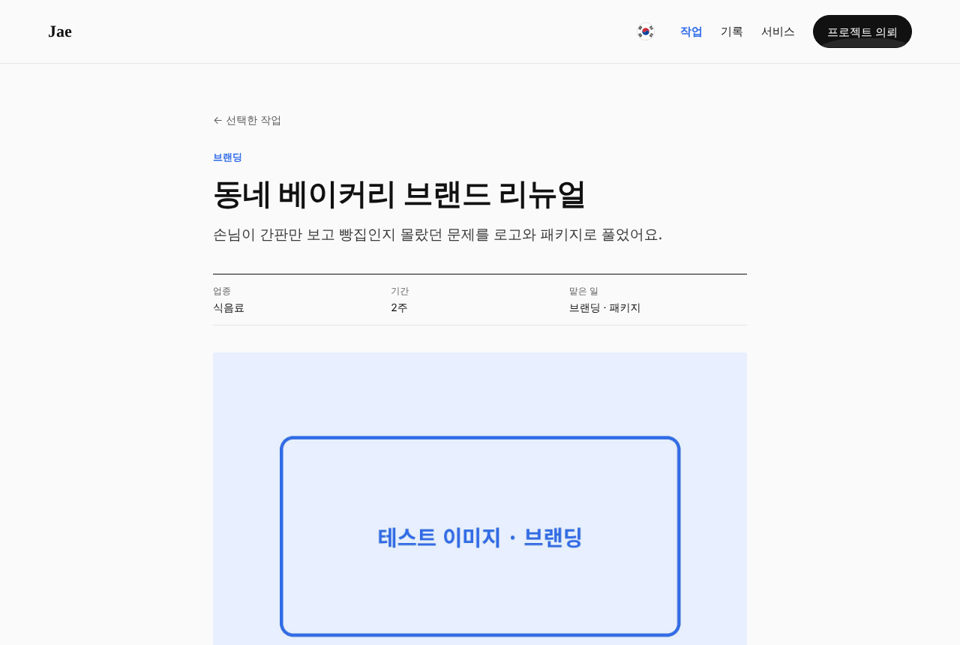
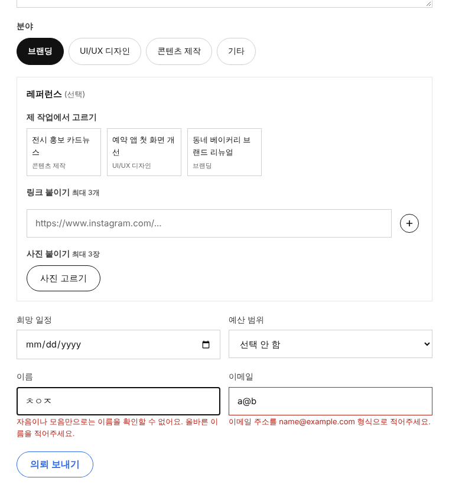
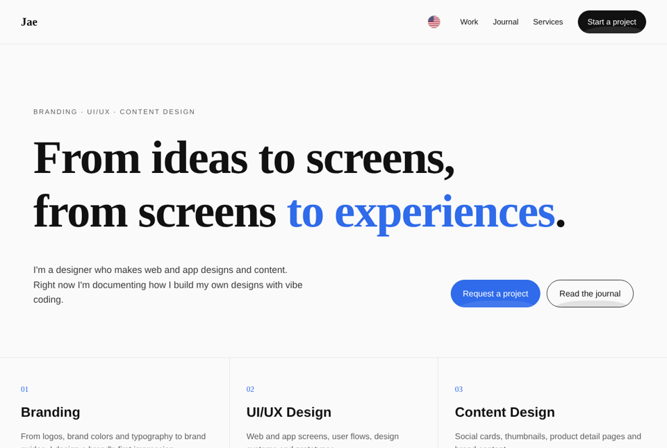
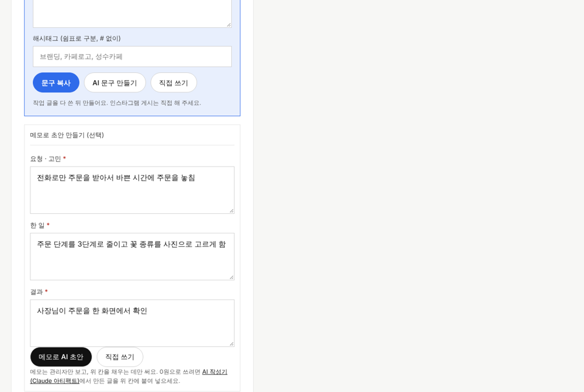
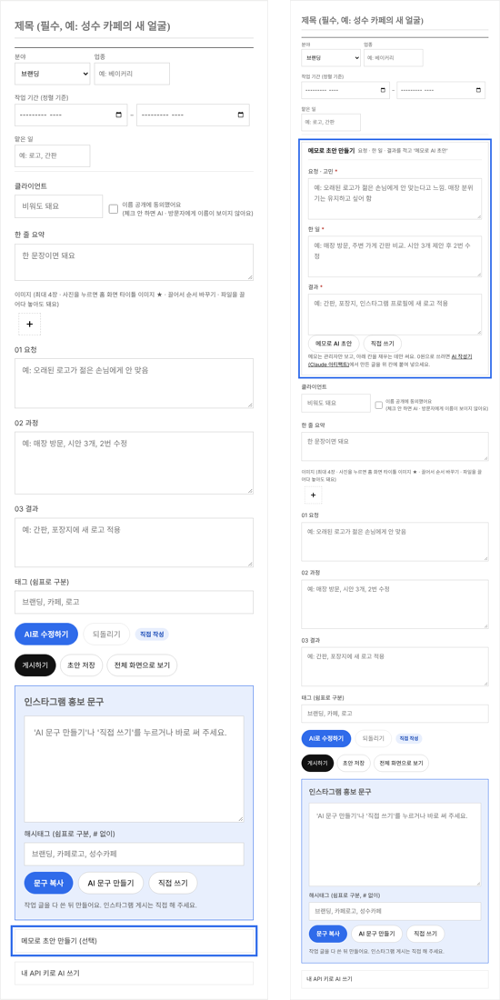
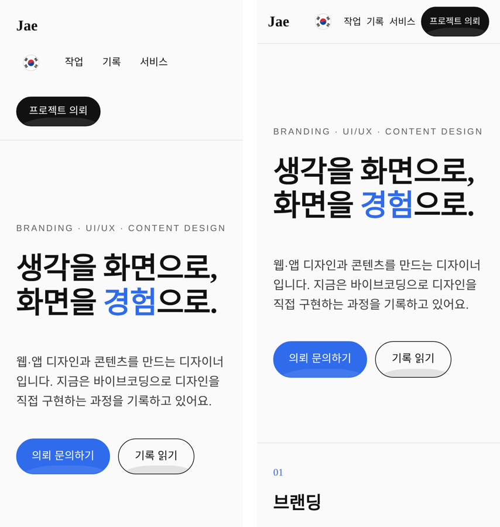
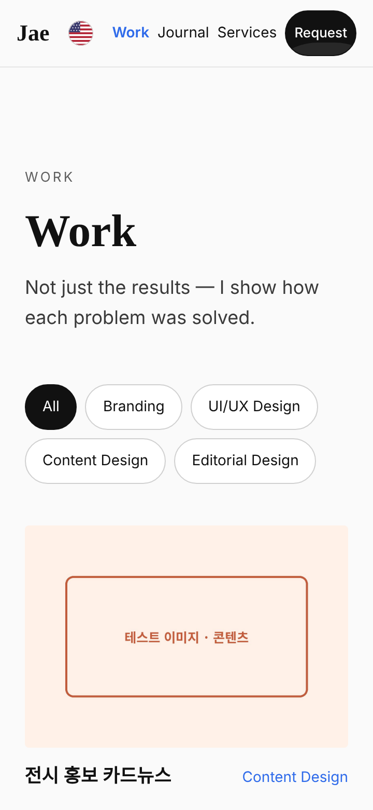

# 테스트 보고서: AI 케이스 스터디 작성기 (Jae 블로그)

| 항목 | 내용 |
|---|---|
| 문서 버전 · 작성 | v1.4 (기준 PRD v1.5, 이전 버전은 커밋 기록) · 2026-11-25 · J |
| 대상 | **실제 사이트 코드**(`main`)를 로컬에서 실행, Firebase만 가짜 데이터로 대체 · 크롬 1280×860, 모바일 360×780 |
| 방법 | 자동 테스트 [`tests/site-flow/`](../tests/site-flow/) 37건(`flow.js` 29 · `cover.js` 8) + 운영자 실측 + 휴리스틱 평가 + 실제 방문자 GA4 (D35) |
| 결과 | **자동 37건 중 37건 통과** (방문자 12 · 비기능 6 · 관리자 11 · 타이틀 이미지 8), 휴리스틱 지적 4건 중 3건 해결, 화면 스크립트 오류 0건 |

## 1. 유저플로우 스크린샷 (실제 사이트)

화면의 작업 3건은 테스트용 예시 데이터임. 원본과 전체 화면은 [screenshots/site/](screenshots/site/), 이전 프로토타입 기준 24/24는 v1.2 커밋에 있음.
**방문자: 홈 → 한 줄 의뢰 → 작업 상세 → 의뢰서 → 접수 / 관리자: 메모 → 초안 → 미리보기 → 게시 → 문구**

| ① 홈 (V01) | ② 한 줄 의뢰 · 분야 추정 (F1 · V03) | ③ 작업 상세 (F3 · V04) | ④ 입력 오류 안내 (F2 · V07) | ⑤ 레퍼런스 · 사진 (F2 · V08) | ⑥ 접수 완료 (V09) |
|---|---|---|---|---|---|
|  |  |  |  |  |  |
| **⑦ English (V10)** | **⑧ 모바일 360px (N01 · N02 · N04)** | **⑨ 메모 입력 (F4 · A02 · A11)** | **⑩ AI 꺼짐 → 문장 틀 (F5 · A03)** | **⑪ 게시 미리보기 (F6 · A05)** | **⑫ 인스타그램 문구 (F7 · A07)** |
|  |  |  |  |  |  |

## 2. 기능별 단위 테스트 (자동 37건, 모두 통과)

ID 접두어: **V** 방문자 · **N** 비기능(모바일 · 접근성) · **A** 관리자 · **C** 타이틀 이미지 — ID를 누르면 테스트 코드 해당 줄로 이동, 코드에서는 `grep -rn "V07" tests/`로 찾음

| ID | PRD | 테스트 → 기대 결과 |
|---|---|---|
| [V01](../tests/site-flow/flow.js#L16) · [V02](../tests/site-flow/flow.js#L20) · [V03](../tests/site-flow/flow.js#L23) | F1 | 홈 헤딩 · 의뢰 버튼 / 빈 한 줄은 결과 안 열림 / "카페 로고…" → 브랜딩 추정, 비슷한 작업 |
| [V04](../tests/site-flow/flow.js#L27) · [V05](../tests/site-flow/flow.js#L31) | F3 | 상세에 01 요청 · 02 과정 · 03 결과 / 작업 목록에 게시 작업 3건 |
| [V06](../tests/site-flow/flow.js#L38) · [V07](../tests/site-flow/flow.js#L42) · [V08](../tests/site-flow/flow.js#L50) · [V09](../tests/site-flow/flow.js#L55) | F2 | 한 줄 · 분야 미리 채움 / `ㄱㄴㄷ` · `a@b` 안내와 제출 막음 / 레퍼런스 · 링크 · 사진 첨부 → 저장 1건, 접수 화면 |
| [V10](../tests/site-flow/flow.js#L62) · [V10b](../tests/site-flow/flow.js#L64) | 방문자 | 한국어 → English, 새로고침 후 유지 |
| [N01](../tests/site-flow/flow.js#L72) · [N02](../tests/site-flow/flow.js#L76) · [N03](../tests/site-flow/flow.js#L81) | 비기능 | 360px 홈 · 상세 가로 넘침 없음, 홈 버튼 44px 이상 |
| [N04](../tests/site-flow/flow.js#L85) · [N05](../tests/site-flow/flow.js#L86) · [N06](../tests/site-flow/flow.js#L90) | 비기능 | **v1.4 신규** · 360px 헤더 한 줄(80px 이하) / 홈 헤딩 `keep-all` / English 작업 목록도 넘침 없음 (휴리스틱 H2 · H3) |
| [A01](../tests/site-flow/flow.js#L99) · [A02](../tests/site-flow/flow.js#L112) | F4 | 로그인 / 메모 없이 'AI 초안' → "메모를 한 칸 이상 써 주세요" |
| [A11](../tests/site-flow/flow.js#L106) | F4 | **v1.4 신규** · 메모는 접힌 '(선택)' 칸, 클라이언트는 맡은 일 옆 (H1 되돌림) |
| [A03](../tests/site-flow/flow.js#L122) · [A04](../tests/site-flow/flow.js#L125) | F5 | AI 서버 꺼짐 → 안내 후 문장 틀로 대체, 메모 유지 / '직접 쓰기' |
| [A05](../tests/site-flow/flow.js#L129) · [A06](../tests/site-flow/flow.js#L133) · [A07](../tests/site-flow/flow.js#L136) | F6 · F7 | 전체 미리보기에 제목 반영 / 게시 완료 패널 / 인스타그램 문구 3안 |
| [A08](../tests/site-flow/flow.js#L141) · [A09](../tests/site-flow/flow.js#L143) | F3 · F2 | 게시 작업이 방문자 목록에 / 방문자 의뢰가 관리자 의뢰 목록에 |
| [C01](../tests/site-flow/cover.js#L18) · [C02](../tests/site-flow/cover.js#L22) · [C03](../tests/site-flow/cover.js#L23) · [C04](../tests/site-flow/cover.js#L28) · [C05](../tests/site-flow/cover.js#L31) · [C06](../tests/site-flow/cover.js#L35) · [C07](../tests/site-flow/cover.js#L38) | F4 · F3 | 3번째 썸네일을 누르면 타이틀(홈 화면 카드)로 지정 → 사진 순서 · 본문 배치 · 상세 맨 위는 그대로, 홈 카드만 바뀜, 다시 열어도 유지 (D36, [썸네일](screenshots/site/c01-cover-thumbs.png) · [홈](screenshots/site/c02-cover-home.png)) |
| [V11](../tests/site-flow/flow.js#L67) · [A10](../tests/site-flow/flow.js#L145) · [C08](../tests/site-flow/cover.js#L39) | 공통 | 방문자 · 관리자 화면 스크립트 오류 0건 |

서버 · 보안 규칙 테스트(20/20, 18/18 · 24/24 · 7/7)는 [성공 실패 로그](SUCCESS_FAILURE_LOG.md)에 있음.

## 3. 사용성 평가 (지인 테스트 대체, D35)

**① 운영자 실측 (H3 · H4)**: 관리자 화면의 실제 사용자인 운영자가 실제 작업 4건을 게시하며 측정함(11/25).

| 작업 | 메모 → 게시 (목표 20분) | 메모에 없는 사실 (목표 0건) | 그대로 쓴 문단 (목표 60%) |
|---|---|---|---|
| 1 · 2 · 3 · 4 | 24 · 18 · 15 · 15분 | 0 · 0 · 0 · 1건 | 65 · 80 · 50 · 60% |
| 결과 | 평균 18분, 합계 72분 (목표 80분) **달성** | 합계 1건 **미달** | 평균 63.8% **달성** |

1건째만 24분, 2건째부터 20분 안. 4건째 초안에서 순서가 바뀌어 말뜻이 달라진 곳 1건(KR2 미달). 고친 곳은 주로 '-했습니다' 체 긴 문장. → 다음 조치: 프롬프트에 '메모 순서 · 인과 유지', '짧은 해요체'를 넣고 다시 실측할 예정.

**② 휴리스틱 평가 (Nielsen 10원칙) → 1 · 2차 조치**: 1차 조치 후 다시 재서 남은 문제를 2차에서 고침. 수치는 크롬 1280×860 · 360×780 실측.

| 등급 · 원칙 | 문제 (조치 전) | 1차 조치 결과 | 2차 조치 결과 | 검증 |
|---|---|---|---|---|
| **높음** · 시스템과 실제의 일치 | 메모 3칸이 맨 아래 접힌 '(선택)' 칸, 2113px 중 1910px | 이미지 아래로 옮기고 펼침, '(선택)' 삭제 → 932px. 첫 화면(860px) 밖이라 미흡 | 작업 정보 바로 아래로 → 608px ✅. 단, 메모가 작업 정보와 섞여 보인다는 **운영자 피드백으로 되돌림**('(선택)' 칸, 클라이언트는 맡은 일 옆) | [A11](../tests/site-flow/flow.js#L106) |
| **중간** · 미니멀 디자인 | 360px 헤더 3줄 208px(첫 화면 27%) | 600px 이하 한 줄 → **65px(8%)** | 1차 뒤 English 모드에서 'Start a project' 버튼이 넘쳐 가로 405px → 'Request' · 간격 8px로 **360px ✅** | [N04](../tests/site-flow/flow.js#L85) · [N06](../tests/site-flow/flow.js#L90) |
| **낮음** · 가독성 | 홈 헤딩 한 글자만 넘어감. 원인: 홈은 `site.css`를 안 불러 `word-break: normal` | 홈 헤딩에 `keep-all` → **어절 단위 줄바꿈 ✅** | 추가 조치 없음 | [N05](../tests/site-flow/flow.js#L86) |
| **정보** · 가시성 | AI 작성기 아티팩트는 소유자만 열림 | 관리자 편집 화면(메모 → 초안) 캡처와 전후 비교 이미지 첨부 | ⏳ 아티팩트 자체 화면 캡처는 운영자 계정에서 첨부 예정 | — |

| 메모 칸 위치 (전 → 후) | 모바일 헤더 · 홈 헤딩 (전 → 후) | English 360px (후) |
|---|---|---|
|  |  |  |

**③ 실제 방문자 GA4 (H1 · H2)**: 11/24~25 '사용자 획득' 기준 **사용자 5명**(관리자 브라우저 제외). 표본 30명 미만 · 공개 직후 집계 지연으로 case_view → request_click · form_start → form_submit 전환율은 **판단 보류**. → 다음 조치: LinkedIn과 커뮤니티 UTM 링크로 4주간 모아 다시 판단할 예정. **한계**: 배포 URL 대신 같은 코드를 로컬에서 실행 · 기본 글꼴로 측정.
