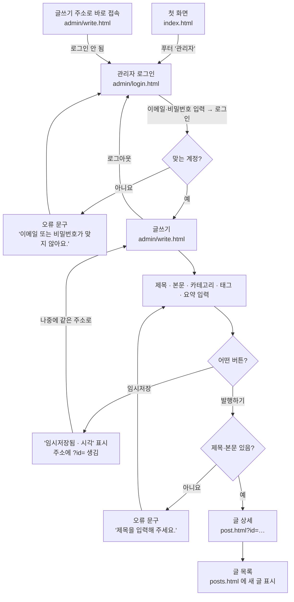

# 사용자 스토리

## US-01 · 관리자는 로그인 후에, 글쓰기 기능으로 글을 직접 쓸 수 있다

> **관리자(블로그 주인)로서,**
> **웹 화면에서 로그인한 뒤 글쓰기 기능으로 글을 직접 쓰고 싶다.**
> **그래야 코드를 고치지 않고도 바이브코딩 수업 기록과 작업 이야기를 바로 블로그에 올릴 수 있기 때문이다.**

### 누가 쓰나 (사용자)
- **관리자 1명**: 블로그 주인. 웹·앱 디자이너. 코드를 몰라도 브라우저만으로 글을 쓰고 싶어요.
- 노트북 브라우저에서 주로 쓰고, 가끔 휴대폰으로 임시저장 글을 이어 써요.

### 시작 조건
- 관리자 계정(이메일 · 비밀번호)이 하나 있어요.
- 블로그 사이트(`https://yj-choi746.github.io/blog-261117/`)에 들어갈 수 있어요.

---

## 사용자 플로우

### 한눈에 보기



### 단계별 화면 흐름

| 단계 | 화면 (페이지) | 관리자가 하는 일 | 화면이 보여주는 것 |
|---|---|---|---|
| 1 | 첫 화면 `index.html` | 맨 아래 푸터의 **관리자**를 눌러요 | 로그인 화면으로 이동 |
| 2 | 관리자 로그인 `admin/login.html` | 이메일 · 비밀번호를 쓰고 **로그인** | 필요하면 **보기**로 비밀번호 확인. 로그인 중엔 버튼이 "로그인 중…" |
| 3 | 글쓰기 `admin/write.html` | — | 위쪽에 **관리자** 배지와 내 이메일, 상태 "새 글 · 저장되지 않음" |
| 4 | 글쓰기 | **제목**, **본문**을 써요 | 본문 아래 서식 안내 (`##` 소제목, `-` 목록, `>` 인용, ``` 코드) |
| 5 | 글쓰기 (오른쪽 발행 설정) | **카테고리**(바이브코딩·디자인·콘텐츠), **태그**, **요약** 입력 | 요약은 글 목록에 보인다는 안내 |
| 6 | 글쓰기 | **임시저장** | "임시저장됨 · 14:32". 주소가 `write.html?id=…`로 바뀌어 새로고침해도 이어 쓸 수 있어요 |
| 7 | 글쓰기 | **발행하기** | "발행하는 중…" → 글 상세로 이동 |
| 8 | 글 상세 `post.html?id=…` | 쓴 글을 확인해요 | 카테고리 · 제목 · 날짜 · 본문(서식 적용) · 태그 |
| 9 | 글 목록 `posts.html` | 상단 **기록** 메뉴 | 맨 위에 새 글. 카테고리 필터로도 찾을 수 있어요 |
| 10 | 글쓰기 | 다 쓰면 **로그아웃** | 로그인 화면으로 이동. 다시 글쓰기 주소로 가도 로그인 화면이 나와요 |

### 다른 흐름 (예외)

| 상황 | 화면의 반응 |
|---|---|
| 로그인하지 않고 글쓰기 주소로 바로 감 | 로그인 화면으로 보내요. 로그인하면 글쓰기로 돌아와요 |
| 이미 로그인한 채 로그인 화면에 감 | 바로 글쓰기로 보내요 |
| 비밀번호가 틀림 | "이메일 또는 비밀번호가 맞지 않아요." |
| 로그인을 여러 번 틀림 | "로그인 시도가 너무 많아요. 잠시 후 다시 시도해 주세요." |
| 제목 없이 임시저장·발행 | "제목을 입력해 주세요." + 제목 칸으로 이동 |
| 본문 없이 발행 | "발행하려면 본문을 입력해 주세요." (임시저장은 가능) |
| 인터넷이 끊김 | "인터넷 연결을 확인해 주세요." 쓴 내용은 화면에 그대로 남아요 |
| 임시저장 글을 다른 사람이 주소로 열어봄 | "글을 찾을 수 없어요." (관리자에게만 보여요) |
| 발행한 글을 고치고 싶음 | 글쓰기 주소 `write.html?id=…`로 열어 고친 뒤 다시 발행 |

---

## 완료 기준 (Given · When · Then)

| # | 상황 (Given) | 행동 (When) | 결과 (Then) | 테스트 |
|---|---|---|---|---|
| 1 | 로그인하지 않음 | 글쓰기 주소로 감 | 로그인 화면으로 이동 | 통과 |
| 2 | 로그인 화면 | 틀린 비밀번호로 로그인 | 이유를 알려주는 오류 문구 | 통과 |
| 3 | 로그인 화면 | 맞는 계정으로 로그인 | 글쓰기 화면 + 내 이메일 표시 | 통과 |
| 4 | 글쓰기 화면 | 제목 없이 저장·발행 | 막히고 "제목을 입력해 주세요." | 통과 |
| 5 | 글쓰기 화면 | 임시저장 | "임시저장됨 · 시각", 새로고침해도 이어 쓰기 | 통과 |
| 6 | 임시저장 글이 있음 | 로그아웃 상태로 그 글을 열거나 글 목록을 봄 | 보이지 않음 | 통과* |
| 7 | 글쓰기 화면 | 발행하기 | 글 상세로 이동, 글 목록에도 나타남 | 통과 |
| 8 | 본문에 ##, -, >, ``` 사용 | 글 상세를 봄 | 소제목·목록·인용·코드 서식으로 보임 | 통과 |
| 9 | 본문에 HTML(`<script>`) 입력 | 글 상세를 봄 | 실행되지 않고 글자로 보임 | 통과 |
| 10 | 로그인 상태 | 로그아웃 | 다시 글쓰기가 막힘 | 통과 |
| 11 | 휴대폰(360px) | 로그인·글쓰기·글 목록을 엶 | 가로로 넘치지 않음 | 통과 |
| 12 | Firebase 설정이 없음 | 로그인 화면을 엶 | 안내 문구 + 로그인 버튼 비활성 | 통과 |

\* 테스트는 실제 Firebase 대신 똑같이 흉내 내는 가짜 Firebase로 했어요 (2026-11-17). 6번의 보안 규칙은 실제 Firebase에 연결한 뒤 한 번 더 확인해요.

---

## 구현 현황

**상태**: 완료 · 실제 사이트에서 관리자가 글 2개를 발행함 (2026-11-17). 이후 글쓰기 화면은 US-03의 서식 에디터로 바뀌었어요.

| 플로우 단계 | 파일 |
|---|---|
| 1 첫 화면 → 관리자 | `index.html` (푸터 "관리자" 링크) |
| 2 로그인 | `admin/login.html`, `js/login.js` |
| 3–7 글쓰기 · 임시저장 · 발행 · 로그아웃 | `admin/write.html`, `js/write.js`, `js/editor.js` |
| 8 글 상세 | `post.html`, `js/post.js`, `js/render.js` |
| 9 글 목록 | `posts.html`, `js/posts.js` |
| 공통 | `js/firebase.js`, `js/firebase-config.js`, `css/site.css`, `firestore.rules` |

---

## US-02 · 관리자는 글 관리 화면에서 글을 고치고, 지우고, 다시 발행하고, 공개 범위를 바꿀 수 있다

> **관리자로서,** 로그인하면 내 글 전체를 한 화면에서 보고 **수정 · 삭제 · 재발행 · 공개/비공개**를 바로 하고 싶다.
> **그래야** 글을 하나씩 찾아 들어가지 않고도 블로그를 정리할 수 있기 때문이다.

**플로우**: 첫 화면 푸터 **관리자** → 로그인 → **글 관리**(`admin/posts.html`) → 글 줄마다 [공개 범위 ▾] [보기] [재발행] [수정] [삭제]

| # | 완료 기준 | 테스트 |
|---|---|---|
| 1 | 푸터 "관리자"로 로그인하면 글 관리 화면이 열린다 | 통과 |
| 2 | 모든 글(발행·임시저장·비공개)이 보이고, 상태 탭·검색으로 걸러진다 | 통과 |
| 3 | **수정**을 누르면 글쓰기 화면에 그 글이 열리고, 고쳐서 발행하면 반영된다 (처음 발행일은 유지) | 통과 |
| 4 | **삭제**는 "정말 삭제할까요?"로 한 번 더 묻고, 취소할 수 있다. 지우면 글에 쓴 사진도 함께 지워진다 | 통과 |
| 5 | **공개 범위**(전체 공개 · 비공개 · 임시저장)를 목록에서 바로 바꾼다. 비공개면 방문자 목록에서 사라진다 | 통과 |
| 6 | **재발행**하면 발행일이 지금으로 바뀌어 글 목록 맨 위로 온다. 임시저장 글은 **발행** 버튼으로 바로 발행된다 | 통과 |
| 7 | 로그인한 관리자에게는 방문자용 글 목록·글 상세에도 수정·삭제 버튼이 보이고, 방문자에게는 보이지 않는다 | 통과 |
| 8 | 방문자가 몰래 지우거나 공개 범위를 바꾸려 하면 보안 규칙이 막는다 | 통과* |

## US-03 · 관리자는 글꼴·색·사진으로 글을 꾸며 진짜 블로그처럼 쓸 수 있다

> **관리자로서,** 네이버 블로그처럼 글꼴·크기·색·정렬을 바꾸고 사진을 넣어 글을 꾸미고 싶다.
> **그래야** 디자이너다운 글을 블로그에 올릴 수 있기 때문이다.

**플로우**: 글쓰기 → 위쪽 서식 도구로 꾸미기 → 사진(버튼 · 끌어다 놓기 · 붙여넣기) → 사진 눌러 크기 · 대표 이미지 → 미리보기 → 발행(공개/비공개)

| # | 완료 기준 | 테스트 |
|---|---|---|
| 1 | 글꼴 6가지(기본 고딕 · 명조 · 나눔고딕 · 나눔명조 · 고운돋움 · 나눔손글씨 펜), 크기 7단계(13~38px) | 통과 |
| 2 | 굵게 · 기울임 · 밑줄 · 취소선 · 글자 색 · 배경 색 · 정렬 · 목록 · 소제목 · 인용구 · 코드 · 구분선 · 링크 · 실행 취소 | 통과 |
| 3 | 사진을 넣으면 자동으로 줄여 저장하고, 크게/중간/작게 · 대표 이미지 · 삭제를 고를 수 있다 | 통과 |
| 4 | 다른 곳에서 붙여넣어도 위험한 코드와 허용 안 된 스타일은 사라진다 | 통과 |
| 5 | 미리보기에서 발행될 모습을 본다 | 통과 |
| 6 | 저장하지 않고 닫아도, 다시 열면 이 브라우저에 남은 글을 불러올 수 있다 (5초마다 자동 백업) | 통과 |
| 7 | 글 상세 · 글 목록에 서식 · 사진 · 대표 이미지 · 썸네일이 보인다 | 통과 |
| 8 | 예전 방식(마크다운)으로 쓴 글도 그대로 보이고, 에디터로 열면 서식 있는 글로 바뀐다 | 통과 |

## US-04 · 방문자는 첫 화면의 "최근 기록"에서 실제 최신 글을 카테고리별로 본다

| # | 완료 기준 | 테스트 |
|---|---|---|
| 1 | 발행된 글 최신 5개가 날짜와 함께 보이고, 누르면 글 상세로 간다 (임시저장·비공개는 안 보임) | 통과 |
| 2 | 전체 · 바이브코딩 · 디자인 · 콘텐츠 버튼으로 거르고, 고른 버튼이 검정으로 바뀐다 | 통과 |
| 3 | 글이 없는 카테고리는 안내 문구를 보여준다 · "모든 기록 보기"로 글 목록에 간다 | 통과 |
| 4 | 의뢰 안내 문구: "영업일 기준 3일 안에 답장" | 통과 |

\* 모든 테스트는 실제 Firebase와 똑같이 권한을 검사하는 가짜 Firebase로 했어요 (2026-11-17, 6개 묶음 104개 통과). 실제 Firebase에는 **바뀐 보안 규칙을 다시 게시**해야 비공개 · 사진 기능이 동작해요.

### 다음 스토리 후보
- 예약 발행 (정해진 시간에 공개)
- 에디터에서 지운 사진 정리
- 사진이 많아지면 Firebase Storage(Blaze 요금제)로 옮기기
