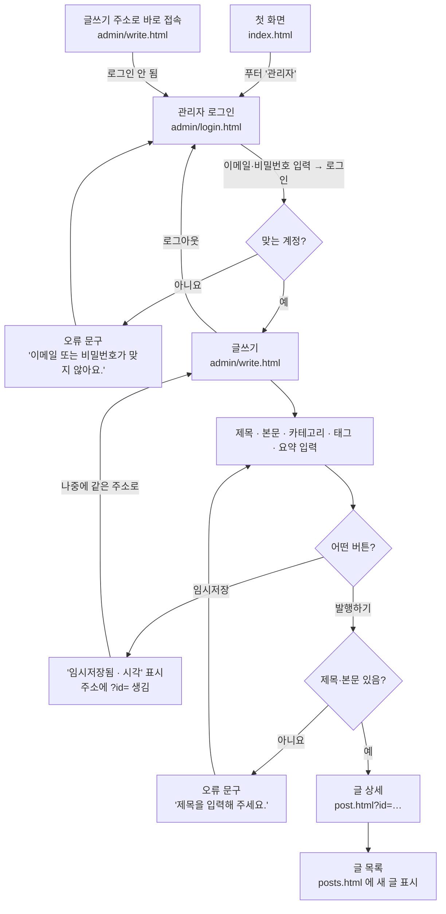

# 사용자 스토리

## US-01 · 관리자는 로그인 후에, 글쓰기 기능으로 글을 직접 쓸 수 있다

> **관리자(블로그 주인)로서,**
> **웹 화면에서 로그인한 뒤 글쓰기 기능으로 글을 직접 쓰고 싶다.**
> **그래야 코드를 고치지 않고도 바이브코딩 수업 기록과 작업 이야기를 바로 블로그에 올릴 수 있기 때문이다.**

### 누가 쓰나 (사용자)
- **관리자 1명**: 블로그 주인. 웹·앱 디자이너. 코드를 몰라도 브라우저만으로 글을 쓰고 싶어요.
- 노트북 브라우저에서 주로 쓰고, 가끔 휴대폰으로 임시저장 글을 이어 써요.

### 시작 조건
- 관리자 계정(이메일 · 비밀번호)이 하나 있어요.
- 블로그 사이트(`https://yj-choi746.github.io/blog-261117/`)에 들어갈 수 있어요.

---

## 사용자 플로우

### 한눈에 보기



### 단계별 화면 흐름

| 단계 | 화면 (페이지) | 관리자가 하는 일 | 화면이 보여주는 것 |
|---|---|---|---|
| 1 | 첫 화면 `index.html` | 맨 아래 푸터의 **관리자**를 눌러요 | 로그인 화면으로 이동 |
| 2 | 관리자 로그인 `admin/login.html` | 이메일 · 비밀번호를 쓰고 **로그인** | 필요하면 **보기**로 비밀번호 확인. 로그인 중엔 버튼이 "로그인 중…" |
| 3 | 글쓰기 `admin/write.html` | — | 위쪽에 **관리자** 배지와 내 이메일, 상태 "새 글 · 저장되지 않음" |
| 4 | 글쓰기 | **제목**, **본문**을 써요 | 본문 아래 서식 안내 (`##` 소제목, `-` 목록, `>` 인용, ``` 코드) |
| 5 | 글쓰기 (오른쪽 발행 설정) | **카테고리**(바이브코딩·디자인·콘텐츠), **태그**, **요약** 입력 | 요약은 글 목록에 보인다는 안내 |
| 6 | 글쓰기 | **임시저장** | "임시저장됨 · 14:32". 주소가 `write.html?id=…`로 바뀌어 새로고침해도 이어 쓸 수 있어요 |
| 7 | 글쓰기 | **발행하기** | "발행하는 중…" → 글 상세로 이동 |
| 8 | 글 상세 `post.html?id=…` | 쓴 글을 확인해요 | 카테고리 · 제목 · 날짜 · 본문(서식 적용) · 태그 |
| 9 | 글 목록 `posts.html` | 상단 **기록** 메뉴 | 맨 위에 새 글. 카테고리 필터로도 찾을 수 있어요 |
| 10 | 글쓰기 | 다 쓰면 **로그아웃** | 로그인 화면으로 이동. 다시 글쓰기 주소로 가도 로그인 화면이 나와요 |

### 다른 흐름 (예외)

| 상황 | 화면의 반응 |
|---|---|
| 로그인하지 않고 글쓰기 주소로 바로 감 | 로그인 화면으로 보내요. 로그인하면 글쓰기로 돌아와요 |
| 이미 로그인한 채 로그인 화면에 감 | 바로 글쓰기로 보내요 |
| 비밀번호가 틀림 | "이메일 또는 비밀번호가 맞지 않아요." |
| 로그인을 여러 번 틀림 | "로그인 시도가 너무 많아요. 잠시 후 다시 시도해 주세요." |
| 제목 없이 임시저장·발행 | "제목을 입력해 주세요." + 제목 칸으로 이동 |
| 본문 없이 발행 | "발행하려면 본문을 입력해 주세요." (임시저장은 가능) |
| 인터넷이 끊김 | "인터넷 연결을 확인해 주세요." 쓴 내용은 화면에 그대로 남아요 |
| 임시저장 글을 다른 사람이 주소로 열어봄 | "글을 찾을 수 없어요." (관리자에게만 보여요) |
| 발행한 글을 고치고 싶음 | 글쓰기 주소 `write.html?id=…`로 열어 고친 뒤 다시 발행 |

---

## 완료 기준 (Given · When · Then)

| # | 상황 (Given) | 행동 (When) | 결과 (Then) | 테스트 |
|---|---|---|---|---|
| 1 | 로그인하지 않음 | 글쓰기 주소로 감 | 로그인 화면으로 이동 | 통과 |
| 2 | 로그인 화면 | 틀린 비밀번호로 로그인 | 이유를 알려주는 오류 문구 | 통과 |
| 3 | 로그인 화면 | 맞는 계정으로 로그인 | 글쓰기 화면 + 내 이메일 표시 | 통과 |
| 4 | 글쓰기 화면 | 제목 없이 저장·발행 | 막히고 "제목을 입력해 주세요." | 통과 |
| 5 | 글쓰기 화면 | 임시저장 | "임시저장됨 · 시각", 새로고침해도 이어 쓰기 | 통과 |
| 6 | 임시저장 글이 있음 | 로그아웃 상태로 그 글을 열거나 글 목록을 봄 | 보이지 않음 | 통과* |
| 7 | 글쓰기 화면 | 발행하기 | 글 상세로 이동, 글 목록에도 나타남 | 통과 |
| 8 | 본문에 ##, -, >, ``` 사용 | 글 상세를 봄 | 소제목·목록·인용·코드 서식으로 보임 | 통과 |
| 9 | 본문에 HTML(`<script>`) 입력 | 글 상세를 봄 | 실행되지 않고 글자로 보임 | 통과 |
| 10 | 로그인 상태 | 로그아웃 | 다시 글쓰기가 막힘 | 통과 |
| 11 | 휴대폰(360px) | 로그인·글쓰기·글 목록을 엶 | 가로로 넘치지 않음 | 통과 |
| 12 | Firebase 설정이 없음 | 로그인 화면을 엶 | 안내 문구 + 로그인 버튼 비활성 | 통과 |

\* 테스트는 실제 Firebase 대신 똑같이 흉내 내는 가짜 Firebase로 했어요 (2026-11-17). 6번의 보안 규칙은 실제 Firebase에 연결한 뒤 한 번 더 확인해요.

---

## 구현 현황

**상태**: 화면·코드 완료 · 가짜 Firebase로 브라우저 테스트 통과 · Firebase 설정값 입력 완료 (프로젝트 `blog---261117`) · **Firebase 콘솔 작업 대기** (Authentication 시작, Firestore 생성, 관리자 UID → `docs/firebase-setup.md` 3~5번)

| 플로우 단계 | 파일 |
|---|---|
| 1 첫 화면 → 관리자 | `index.html` (푸터 "관리자" 링크) |
| 2 로그인 | `admin/login.html`, `js/login.js` |
| 3–7 글쓰기 · 임시저장 · 발행 · 로그아웃 | `admin/write.html`, `js/write.js` |
| 8 글 상세 | `post.html`, `js/post.js`, `js/render.js` |
| 9 글 목록 | `posts.html`, `js/posts.js` |
| 공통 | `js/firebase.js`, `js/firebase-config.js`, `css/site.css`, `firestore.rules` |

### 이 스토리에 넣지 않은 것 (다음 스토리 후보)
- US-02 · 관리자는 글 목록에서 글을 골라 고치거나 지울 수 있다 (지금은 `?id=` 주소로만 고침)
- US-03 · 관리자는 글에 대표 이미지를 올릴 수 있다 (Firebase Storage 필요)
- US-04 · 방문자는 첫 화면의 "최근 기록"에서 실제 최신 글을 본다
