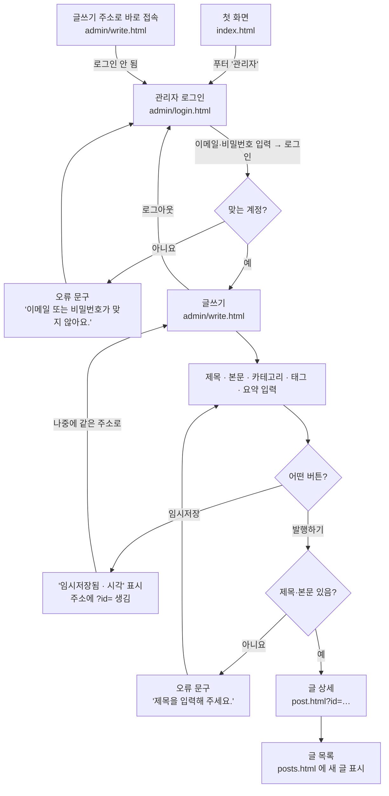

# 사용자 스토리

## US-01 · 관리자는 로그인 후에, 글쓰기 기능으로 글을 직접 쓸 수 있다

> **관리자(블로그 주인)로서,**
> **웹 화면에서 로그인한 뒤 글쓰기 기능으로 글을 직접 쓰고 싶다.**
> **그래야 코드를 고치지 않고도 바이브코딩 수업 기록과 작업 이야기를 바로 블로그에 올릴 수 있기 때문이다.**

### 누가 쓰나 (사용자)
- **관리자 1명**: 블로그 주인. 웹·앱 디자이너. 코드를 몰라도 브라우저만으로 글을 쓰고 싶어요.
- 노트북 브라우저에서 주로 쓰고, 가끔 휴대폰으로 임시저장 글을 이어 써요.

### 시작 조건
- 관리자 계정(이메일 · 비밀번호)이 하나 있어요.
- 블로그 사이트(`https://yj-choi746.github.io/blog-261117/`)에 들어갈 수 있어요.

---

## 사용자 플로우

### 한눈에 보기



### 단계별 화면 흐름

| 단계 | 화면 (페이지) | 관리자가 하는 일 | 화면이 보여주는 것 |
|---|---|---|---|
| 1 | 첫 화면 `index.html` | 맨 아래 푸터의 **관리자**를 눌러요 | 로그인 화면으로 이동 |
| 2 | 관리자 로그인 `admin/login.html` | 이메일 · 비밀번호를 쓰고 **로그인** | 필요하면 **보기**로 비밀번호 확인. 로그인 중엔 버튼이 "로그인 중…" |
| 3 | 글쓰기 `admin/write.html` | — | 위쪽에 **관리자** 배지와 내 이메일, 상태 "새 글 · 저장되지 않음" |
| 4 | 글쓰기 | **제목**, **본문**을 써요 | 본문 아래 서식 안내 (`##` 소제목, `-` 목록, `>` 인용, ``` 코드) |
| 5 | 글쓰기 (오른쪽 발행 설정) | **카테고리**(바이브코딩·디자인·콘텐츠), **태그**, **요약** 입력 | 요약은 글 목록에 보인다는 안내 |
| 6 | 글쓰기 | **임시저장** | "임시저장됨 · 14:32". 주소가 `write.html?id=…`로 바뀌어 새로고침해도 이어 쓸 수 있어요 |
| 7 | 글쓰기 | **발행하기** | "발행하는 중…" → 글 상세로 이동 |
| 8 | 글 상세 `post.html?id=…` | 쓴 글을 확인해요 | 카테고리 · 제목 · 날짜 · 본문(서식 적용) · 태그 |
| 9 | 글 목록 `posts.html` | 상단 **기록** 메뉴 | 맨 위에 새 글. 카테고리 필터로도 찾을 수 있어요 |
| 10 | 글쓰기 | 다 쓰면 **로그아웃** | 로그인 화면으로 이동. 다시 글쓰기 주소로 가도 로그인 화면이 나와요 |

### 다른 흐름 (예외)

| 상황 | 화면의 반응 |
|---|---|
| 로그인하지 않고 글쓰기 주소로 바로 감 | 로그인 화면으로 보내요. 로그인하면 글쓰기로 돌아와요 |
| 이미 로그인한 채 로그인 화면에 감 | 바로 글쓰기로 보내요 |
| 비밀번호가 틀림 | "이메일 또는 비밀번호가 맞지 않아요." |
| 로그인을 여러 번 틀림 | "로그인 시도가 너무 많아요. 잠시 후 다시 시도해 주세요." |
| 제목 없이 임시저장·발행 | "제목을 입력해 주세요." + 제목 칸으로 이동 |
| 본문 없이 발행 | "발행하려면 본문을 입력해 주세요." (임시저장은 가능) |
| 인터넷이 끊김 | "인터넷 연결을 확인해 주세요." 쓴 내용은 화면에 그대로 남아요 |
| 임시저장 글을 다른 사람이 주소로 열어봄 | "글을 찾을 수 없어요." (관리자에게만 보여요) |
| 발행한 글을 고치고 싶음 | 글쓰기 주소 `write.html?id=…`로 열어 고친 뒤 다시 발행 |

---

## 완료 기준 (Given · When · Then)

| # | 상황 (Given) | 행동 (When) | 결과 (Then) | 테스트 |
|---|---|---|---|---|
| 1 | 로그인하지 않음 | 글쓰기 주소로 감 | 로그인 화면으로 이동 | 통과 |
| 2 | 로그인 화면 | 틀린 비밀번호로 로그인 | 이유를 알려주는 오류 문구 | 통과 |
| 3 | 로그인 화면 | 맞는 계정으로 로그인 | 글쓰기 화면 + 내 이메일 표시 | 통과 |
| 4 | 글쓰기 화면 | 제목 없이 저장·발행 | 막히고 "제목을 입력해 주세요." | 통과 |
| 5 | 글쓰기 화면 | 임시저장 | "임시저장됨 · 시각", 새로고침해도 이어 쓰기 | 통과 |
| 6 | 임시저장 글이 있음 | 로그아웃 상태로 그 글을 열거나 글 목록을 봄 | 보이지 않음 | 통과* |
| 7 | 글쓰기 화면 | 발행하기 | 글 상세로 이동, 글 목록에도 나타남 | 통과 |
| 8 | 본문에 ##, -, >, ``` 사용 | 글 상세를 봄 | 소제목·목록·인용·코드 서식으로 보임 | 통과 |
| 9 | 본문에 HTML(`<script>`) 입력 | 글 상세를 봄 | 실행되지 않고 글자로 보임 | 통과 |
| 10 | 로그인 상태 | 로그아웃 | 다시 글쓰기가 막힘 | 통과 |
| 11 | 휴대폰(360px) | 로그인·글쓰기·글 목록을 엶 | 가로로 넘치지 않음 | 통과 |
| 12 | Firebase 설정이 없음 | 로그인 화면을 엶 | 안내 문구 + 로그인 버튼 비활성 | 통과 |

\* 테스트는 실제 Firebase 대신 똑같이 흉내 내는 가짜 Firebase로 했어요 (2026-11-17). 6번의 보안 규칙은 실제 Firebase에 연결한 뒤 한 번 더 확인해요.

---

## 구현 현황

**상태**: 완료 · 실제 사이트에서 관리자가 글 2개를 발행함 (2026-11-17). 이후 글쓰기 화면은 US-03의 서식 에디터로 바뀌었어요.

| 플로우 단계 | 파일 |
|---|---|
| 1 첫 화면 → 관리자 | `index.html` (푸터 "관리자" 링크) |
| 2 로그인 | `admin/login.html`, `js/login.js` |
| 3–7 글쓰기 · 임시저장 · 발행 · 로그아웃 | `admin/write.html`, `js/write.js`, `js/editor.js` |
| 8 글 상세 | `post.html`, `js/post.js`, `js/render.js` |
| 9 글 목록 | `posts.html`, `js/posts.js` |
| 공통 | `js/firebase.js`, `js/firebase-config.js`, `css/site.css`, `firestore.rules` |

---

## US-02 · 관리자는 글 관리 화면에서 글을 고치고, 지우고, 공개 범위를 바꿀 수 있다

> **관리자로서,** 로그인하면 내 글 전체를 한 화면에서 보고 **수정 · 삭제 · 공개/비공개**를 바로 하고 싶다.
> **그래야** 글을 하나씩 찾아 들어가지 않고도 블로그를 정리할 수 있기 때문이다.

**플로우**: 첫 화면 푸터 **관리자** → 로그인 → **글 관리**(`admin/posts.html`) → 글 줄마다 한 줄로 [공개 범위 ▾] [보기] [수정] [삭제]

| # | 완료 기준 | 테스트 |
|---|---|---|
| 1 | 푸터 "관리자"로 로그인하면 글 관리 화면이 열린다 | 통과 |
| 2 | 모든 글(발행·임시저장·비공개)이 보이고, 상태 탭·검색으로 걸러진다 | 통과 |
| 3 | **수정**을 누르면 글쓰기 화면에 그 글이 열리고, 고쳐서 발행하면 반영된다 (처음 발행일은 유지) | 통과 |
| 4 | **삭제**는 "정말 삭제할까요?"로 한 번 더 묻고, 취소할 수 있다. 지우면 글에 쓴 사진도 함께 지워진다 | 통과 |
| 5 | **공개 범위**(전체 공개 · 비공개 · 임시저장)를 목록에서 바로 바꾼다. 비공개면 방문자 목록에서 사라진다 | 통과 |
| 6 | 임시저장 글을 공개 범위에서 **전체 공개**로 바꾸면 바로 발행된다 (처음 공개할 때 발행일이 정해짐). 버튼은 화면 폭 900px에서도 한 줄 | 통과 |
| 7 | 로그인한 관리자에게는 방문자용 글 목록·글 상세에도 수정·삭제 버튼이 보이고, 방문자에게는 보이지 않는다 | 통과 |
| 8 | 방문자가 몰래 지우거나 공개 범위를 바꾸려 하면 보안 규칙이 막는다 | 통과* |

## US-03 · 관리자는 글꼴·색·사진으로 글을 꾸며 진짜 블로그처럼 쓸 수 있다

> **관리자로서,** 네이버 블로그처럼 글꼴·크기·색·정렬을 바꾸고 사진을 넣어 글을 꾸미고 싶다.
> **그래야** 디자이너다운 글을 블로그에 올릴 수 있기 때문이다.

**플로우**: 글쓰기 → 위쪽 서식 도구로 꾸미기 → 사진(버튼 · 끌어다 놓기 · 붙여넣기) → 사진 눌러 크기 · 대표 이미지 → 미리보기 → 발행(공개/비공개)

| # | 완료 기준 | 테스트 |
|---|---|---|
| 1 | 글꼴 6가지(기본 고딕 · 명조 · 나눔고딕 · 나눔명조 · 고운돋움 · 나눔손글씨 펜), 크기 7단계(13~38px) | 통과 |
| 2 | 굵게 · 기울임 · 밑줄 · 취소선 · 글자 색 · 배경 색 · 정렬 · 목록 · 소제목 · 인용구 · 코드 · 구분선 · 링크 · 실행 취소 | 통과 |
| 3 | 사진을 넣으면 자동으로 줄여 저장하고, 크게/중간/작게 · 대표 이미지 · 삭제를 고를 수 있다 | 통과 |
| 4 | 다른 곳에서 붙여넣어도 위험한 코드와 허용 안 된 스타일은 사라진다 | 통과 |
| 5 | 미리보기에서 발행될 모습을 본다 | 통과 |
| 6 | 저장하지 않고 닫아도, 다시 열면 이 브라우저에 남은 글을 불러올 수 있다 (5초마다 자동 백업) | 통과 |
| 7 | 글 상세 · 글 목록에 서식 · 사진 · 대표 이미지 · 썸네일이 보인다 | 통과 |
| 8 | 예전 방식(마크다운)으로 쓴 글도 그대로 보이고, 에디터로 열면 서식 있는 글로 바뀐다 | 통과 |

## US-04 · 방문자는 첫 화면의 "최근 기록"에서 실제 최신 글을 카테고리별로 본다

| # | 완료 기준 | 테스트 |
|---|---|---|
| 1 | 발행된 글 최신 5개가 날짜와 함께 보이고, 누르면 글 상세로 간다 (임시저장·비공개는 안 보임) | 통과 |
| 2 | 전체 · 바이브코딩 · 디자인 · 콘텐츠 버튼으로 거르고, 고른 버튼이 검정으로 바뀐다 | 통과 |
| 3 | 글이 없는 카테고리는 안내 문구를 보여준다 · "모든 기록 보기"로 글 목록에 간다 | 통과 |
| 4 | 의뢰 안내 문구: "영업일 기준 3일 안에 답장" | 통과 |

\* 모든 테스트는 실제 Firebase와 똑같이 권한을 검사하는 가짜 Firebase로 했어요 (2026-11-17, 6개 묶음 104개 통과). 실제 Firebase에 바뀐 보안 규칙 게시 완료 (2026-11-17) — 방문자 쪽 권한(읽기 허용 · 쓰기 차단 · 임시저장/비공개 차단)을 실제 서버에서 확인했어요.

## US-05 · 관리자는 방문자 통계를 본다 (Google Analytics)

> **관리자로서,** 홈 · 페이지별 방문자 수, 지역 · 기기 · OS, 가장 많이 읽힌 글을 보고 싶다. **그래야** 어떤 글과 서비스가 반응이 좋은지 알 수 있기 때문이다.

| # | 완료 기준 | 테스트 |
|---|---|---|
| 1 | 홈 · 글 목록 · 글 상세 · 의뢰 완료에서 방문이 GA4(`G-04G5123MB7`)로 기록된다 | 통과 |
| 2 | 글 상세는 **글 제목**으로 한 번만 기록되고, 글 id · 제목 · 카테고리가 `view_post`로 함께 간다 | 통과 |
| 3 | 의뢰 완료 시 `generate_lead`가 기록된다 | 통과 |
| 4 | 관리자 화면은 기록하지 않는다 | 통과 |
| 5 | GA가 막혀도(광고 차단 등) 페이지는 정상 동작한다 | 통과 |
| 6 | 지역 · 기기 · OS는 GA 기본 보고서에서 본다 (보는 곳: `docs/analytics.md`) | 실제 GA 확인 (2026-11-17): 실시간에 글 제목이 보임 |
| 7 | 관리자로 로그인한 브라우저는 방문자 화면을 봐도 집계되지 않는다 (`?ga=on`/`?ga=off`로 바꿀 수 있음) | 통과 |

## US-06 · 관리자는 방문자가 글을 어떻게 찾고 · 읽고 · 의뢰로 이어지는지 본다 (이벤트 택소노미)

설계: `docs/analytics-events.md`

| # | 완료 기준 | 테스트 |
|---|---|---|
| 1 | 의뢰 버튼(5곳 + 글 목록 · 글 상세 헤더)을 누르면 `click_cta`(cta_name · cta_location) | 통과 |
| 2 | 카테고리 버튼은 `filter_posts`, 목록에서 글을 누르면 `select_post`(목록 이름 · 몇 번째) | 통과 |
| 3 | 글 본문을 50% · 90% 읽으면 `read_post` 각 1번 (짧은 글은 다 보이면 바로) | 통과 |
| 4 | 의뢰 폼: 처음 입력 `form_start` 1번, 보내기 `form_submit`(분야 · 예산), 완료 `generate_lead` | 통과 |
| 5 | 이름 · 이메일 · 의뢰 내용은 GA로 가지 않는다 | 통과 |
| 6 | 관리자 브라우저에서는 이벤트가 GA로 가지 않고, 오류도 없다 | 통과 |

## US-07 · 방문자는 글을 다 읽고 바로 아래에서 이전 글 · 다음 글로 넘어간다

| # | 완료 기준 | 테스트 |
|---|---|---|
| 1 | 글 본문 · 태그 바로 아래에 "← 이전 글"(먼저 발행된 글) · "다음 글 →"(나중에 발행된 글)이 보인다 | 통과 |
| 2 | 제목 · 카테고리 · 날짜, 대표 이미지가 있으면 썸네일이 함께 보인다. 긴 제목은 두 줄까지 | 통과 |
| 3 | 가장 오래된 글은 "첫 번째 글이에요", 가장 최근 글은 "가장 최근 글이에요"라고 알려준다 | 통과 |
| 4 | 임시저장 · 비공개 글은 이전 · 다음에 나오지 않고, 그런 글에서는 칸을 숨긴다 | 통과 |
| 5 | 누르면 그 글로 이동하고, GA에 `select_post`(list_name = post_nav_prev / post_nav_next)가 간다 | 통과 |
| 6 | 휴대폰에서는 위아래로 쌓이고 가로로 넘치지 않는다 | 통과 |

**바뀜 (2026-11-17)**: 3번 기준을 "끝에서 한 바퀴 돈다"로 바꿨어요. 가장 최근 글의 "다음 글"이 눌리지 않아 넘어가지 않는다는 의견 → 모든 글에서 두 칸 다 누를 수 있게.

| # | 바뀐 완료 기준 | 테스트 |
|---|---|---|
| 3′ | 첫 글의 이전 칸은 "← 가장 최근 글로", 가장 최근 글의 다음 칸은 "처음 글로 →"로 이어지고 누르면 넘어간다 | 통과 |

## US-08 · 방문자는 글마다 다른 제목 · 설명 · 썸네일을 보고 읽을 글을 고른다

| # | 완료 기준 | 테스트 |
|---|---|---|
| 1 | 첫 화면 최근 기록에 글마다 제목 · 요약 · 대표 이미지 썸네일이 보인다 (대표 이미지가 없으면 썸네일 칸 없이) | 통과 |
| 2 | 글 목록에도 썸네일 · 요약이 보인다 | 통과 |
| 3 | 글 상세 제목 아래에 요약이 보이고, 탭 제목 · 페이지 설명도 글마다 다르다 | 통과 |
| 4 | 휴대폰 360px에서 썸네일이 오른쪽에 붙고 가로로 넘치지 않는다 | 통과 |
| 5 | 카카오톡 · SNS 링크 미리보기도 글마다 다르다: 글 상세 "공유 링크 복사" → `p/글ID.html`에 글 제목 · 요약 · 대표 이미지(og 태그)가 들어 있고, 사람이 열면 글로 바로 넘어간다 | 공유 페이지 생성(실제 글 2개): 통과 · 복사 버튼: 통과 · 실제 카카오톡 미리보기: 배포 후 확인 필요 |
| 6 | 새로 발행한 글도 1시간 안에 공유 페이지가 생긴다 (매시 17분 자동 배포, 바로 원하면 Actions → Run workflow) | 배포 후 확인 필요 |
| 7 | 홈 · 글 목록 주소를 붙여도 미리보기 카드(제목 · 설명 · 대표 이미지)가 뜬다 | og 태그 확인: 통과 · 실제 카카오톡: 배포 후 확인 필요 |

## US-09 · 관리자는 "진짜로 끝까지 읽은" 글과 글이 발행된 날을 함께 본다 (PRD FR-02 완독 보정 · FR-03 게시일 전송)

> **운영자로서,** 실제로 읽은 방문만 완독으로 집계하고, 글을 게시 후 같은 기간 기준으로 비교하고 싶다. **그래야** 짧은 글의 완독률이 부풀려지지 않고, 오래된 글이 유리하지 않다.

기준: PRD "블로그 인기 글 분석 체계" v2.0 · 설계: `docs/analytics-events.md` ("완독 보정", `post_published_at`)

| # | 완료 기준 (PRD 인수조건) | 테스트 |
|---|---|---|
| 1 | 짧은 글을 열고 5초 안에 닫으면 `read_post`가 가지 않는다 | 통과 (4.9초: 없음) |
| 2 | 짧은 글을 열어 두고 최소 시간이 지나면 50 · 90이 각각 1번 간다 (스크롤 없이 2초마다 다시 확인) | 통과 (8초에 50 · 90, 30초 더 지나도 중복 없음) |
| 3 | 긴 글은 끝까지 스크롤하고 시간이 지나야 90이 간다 | 통과 (6000자: 바로 끝까지 내려도 20초엔 없음, 30초 뒤 50, 60초 뒤 90) |
| 4 | 스크롤을 안 하면 시간이 지나도 가지 않는다 | 통과 (400자 글, 40초 동안 없음 → 스크롤하자 바로) |
| 5 | 탭을 숨긴 시간은 세지 않는다 | 통과 (숨김 300초 동안 없음) |
| 6 | `view_post`(+ `read_post`)에 게시일 `post_published_at`(YYYY-MM-DD, 한국 시간)이 간다. 발행 전 글은 `미발행` | 통과 (UTC 11/03 16:30 발행 → `2026-11-04`) |
| 7 | GA DebugView의 `view_post`에 게시일이 보인다 | 배포 후 확인 |
| 8 | GA 맞춤 측정기준 `post_published_at` 등록 (FR-01) | 사용자 GA 로그인 후 |

\* 테스트: 로컬 서버 + 가짜 Firebase + 실제 크롬(Playwright, 시계 빨리 감기), 2026-11-18.

---

## US-10 · 방문자는 글 안에서 오늘의 명언을 받고, 성격을 눌러 어울리는 포켓몬을 본다

| # | 완료 기준 | 테스트 |
|---|---|---|
| 1 | 관리자가 툴바 "명언" · "포켓몬" 버튼으로 본문에 위젯을 넣고, 에디터에서는 안내 상자로 보인다 | 배포 후 확인 필요 |
| 2 | 글 상세 · 미리보기에서 명언 위젯이 열 때마다 새 명언을 보여주고, "다른 명언 보기"로 바꿀 수 있다 | 통과 (로컬 테스트) |
| 3 | 성격 버튼 6개 중 하나를 누르면 PokéAPI에서 포켓몬 그림 · 이름 · 타입 · 도감 글을 불러온다. 실패하면 안내와 "다시 시도" | 통과 (로컬, API 응답은 흉내) |
| 4 | 허용 목록에 없는 위젯 이름 · 위젯 안의 script · onclick · style은 저장 · 화면 모두에서 사라진다 | 통과 |
| 5 | 휴대폰 360px에서 가로로 넘치지 않고 버튼 높이 44px 이상 | 통과 |
| 6 | 위젯 안내 글은 요약 · 글자 수에 들어가지 않는다 | 통과 |

### 다음 스토리 후보
- 예약 발행 (정해진 시간에 공개)
- 에디터에서 지운 사진 정리
- 사진이 많아지면 Firebase Storage(Blaze 요금제)로 옮기기

---

## US-11 · 관리자는 방문자가 본문 어디까지 내려갔고, 몇 초 만에 어디서 떠났는지 본다 (scroll_post · leave_post)

> **관리자로서,** 글을 스크롤하며 얼마나 머물고 어느 지점에서 이탈하는지 알고 싶다. **그래야** 글의 어느 부분에서 독자를 잃는지 보고 고칠 수 있기 때문이다.

설계: `docs/analytics-events.md` (`scroll_post`, `leave_post`)

| # | 완료 기준 | 테스트 |
|---|---|---|
| 1 | 본문 30 · 50 · 90%에 닿는 순간 `scroll_post`가 각각 1번 간다 (시간 조건 없음, 그때까지 머문 초 `engaged_seconds` 포함) | 통과 (35% → 30, 55% → 50) |
| 2 | 위로 올렸다 다시 내려도 중복으로 가지 않는다 | 통과 |
| 3 | 글을 떠날 때 `leave_post`가 1번 간다: 가장 많이 내려간 깊이(10 단위) · 머문 초 · 완독 여부 | 통과 (55%에서 떠남 → `max_scroll_depth` 50, `read_completed` no) |
| 4 | 끝까지 읽고 떠나면 `read_completed` = yes | 통과 (400자 글, 30초 → 100 · yes) |
| 5 | 짧은 글을 2초 만에 떠나면 `scroll_post`는 가도 `read_post`는 가지 않는다 (PRD FR-02 유지) | 통과 |
| 6 | 떠날 때 기록은 페이지가 닫히는 중에도 가도록 beacon으로 보낸다 | 코드 반영, 실제 전송은 배포 후 DebugView 확인 |
| 7 | GA에 `scroll_depth` · `max_scroll_depth` · `read_completed`(측정기준), `engaged_seconds`(측정항목, 초) 등록 | 사용자 GA 등록 필요 |

---

## US-12 · 방문자는 가입 없이 하트 한 번으로 글에 공감하고, 몇 명이 좋아했는지 본다 (PRD FR-04 좋아요)

| # | 완료 기준 (PRD 인수조건) | 테스트 |
|---|---|---|
| 1 | 글 상세 "공유 링크 복사" 옆에 하트 + 숫자. 누르면 1 늘고, 다시 누르면 1 줄어든다 (화면 먼저, 저장 실패 시 되돌림) | 통과 (0 → 1 → 새로고침 1 유지 → 취소 0) |
| 2 | 새로고침해도 숫자가 유지되고, 같은 브라우저에서는 누른 상태로 보인다 (`jae-liked-글ID`) | 통과 |
| 3 | 0 미만이 되지 않는다 | 통과 (보안 규칙: 0에서 -1 거부) |
| 4 | 개발자 도구로 +5 같은 임의 값 · 다른 필드 · 없는 글/비공개 글에 좋아요는 보안 규칙이 거부한다 · 삭제는 관리자만 | 통과 (Firestore 에뮬레이터로 보안 규칙 18개 검사 모두 통과: +5 · 값 직접 쓰기 · 다른 필드 · 문자 값 · 비공개/없는 글 · 처음부터 5 · 방문자/다른 계정 삭제 거부, 관리자 삭제 허용) |
| 5 | GA에 `like_post` · `unlike_post`가 post_id와 함께 간다 | 통과 (`like_post` · `unlike_post`, post_id · 발행일 포함) |
| 6 | 임시저장 · 비공개 글에서는 버튼을 숨긴다 · 휴대폰 360px에서 넘치지 않고 높이 44px 이상 | 통과 (비공개 글에 버튼 없음, 360px에서 두 줄로 감김 · 버튼 44px) |

한계: 로그인이 없어 브라우저 · 기기를 바꾸면 다시 누를 수 있어요 (PRD에서 허용).

## US-13 · 방문자는 다 못 읽은 글을 저장해 두고 글 목록에서 다시 찾는다 (PRD FR-05 스크랩)

| # | 완료 기준 (PRD 인수조건) | 테스트 |
|---|---|---|
| 1 | 글 상세에 "저장 / 저장됨" 버튼. 저장하면 "이 브라우저에만 저장돼요" 안내 | 통과 |
| 2 | 새로고침해도 "저장됨"이 유지되고, 글 목록 "저장한 글" 필터에 나타난다 (최대 100개, `jae-bookmarks`) | 통과 (새로고침 후 "저장됨", 최근 저장 순으로 목록에 나옴) |
| 3 | 삭제 · 비공개된 글은 "저장한 글"에 보이지 않는다 | 통과 (비공개로 바뀐 글은 목록에서 빠짐) |
| 4 | GA에 `bookmark_post` · `unbookmark_post`가 간다 | 통과 (`bookmark_post`, 필터는 `filter_posts` = 저장한 글) |
| 5 | 브라우저 저장소를 못 쓰는 환경에서도 오류 없이 페이지가 동작한다 | 통과 (저장소 막힘: "이 브라우저에서는 저장할 수 없어요" 안내, 오류 없음) |

한계: 다른 기기와 동기화되지 않고, 브라우저 데이터를 지우면 사라져요 (로그인 없이는 해결 불가).

\* 테스트 (2026-11-18): 화면은 로컬 서버 + 가짜 Firebase + 실제 크롬, 보안 규칙은 Firestore 에뮬레이터(실제 규칙 엔진). **실제 서비스에서 좋아요가 저장되려면 바뀐 `firestore.rules`를 Firebase 콘솔에 다시 게시해야 해요.**
